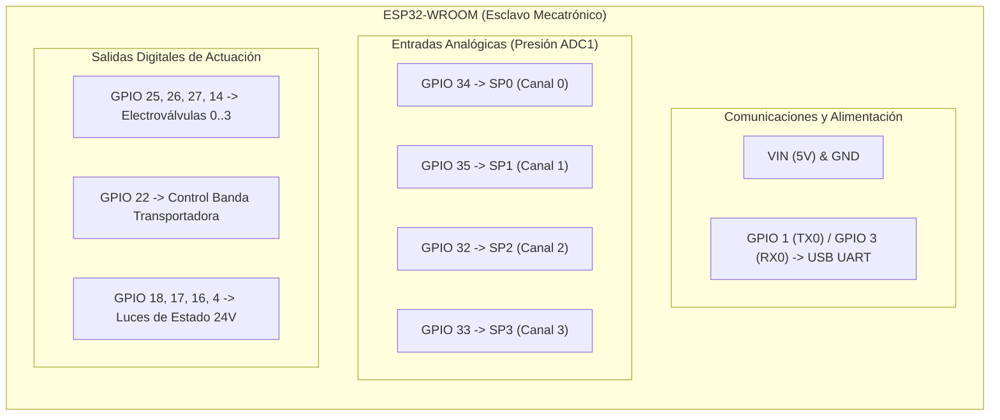

# Especificación y Mapeo de Hardware: ESP32 y Raspberry Pi 5
**Proyecto MOPPI (Finca Alvizua) — Clasificador Óptico de Café Verde v1.6.0**

Este documento consolida la arquitectura física, asignación de pines del microcontrolador **ESP32-WROOM** (esclavo mecatrónico) y la distribución de puertos periféricos de la **Raspberry Pi 5** (maestro de visión artificial e inferencia Edge AI).

---

## 1. Distribución y Conexión de Puertos en la Raspberry Pi 5

La Raspberry Pi 5 centraliza la captura de video dual, la aceleración neuronal (Hailo-8L / YOLO11s), la interfaz gráfica de usuario (HMI) y el enlace serial determinista con el ESP32.

```
       +-------------------------------------------------------+
       |                   RASPBERRY PI 5                      |
       |                                                       |
       |  [USB 3.0 #1] (Azul)  -----> Cámara Superior (Dorsal) |
       |  [USB 3.0 #2] (Azul)  -----> Cámara Inferior (Ventral)|
       |                                                       |
       |  [USB 2.0 #1] (Negro) -----> Enlace Serial ESP32      |
       |  [USB 2.0 #2] (Negro) -----> Controlador Touch Pantalla|
       |                                                       |
       |  [Micro-HDMI #2]      -----> Salida de Video Pantalla |
       +-------------------------------------------------------+
```

### Tabla de Puertos Raspberry Pi 5

| Tipo de Puerto | Conector Físico | Dispositivo Asignado | Función / Descripción Técnica |
| :--- | :--- | :--- | :--- |
| **USB 3.0 (Azul)** | Puerto Superior USB 3.0 | **Cámara Superior (Dorsal)** | Inspección dorsal del grano, asignación analítica de carril virtual (0..3) y detección de línea de cruce para eyección. |
| **USB 3.0 (Azul)** | Puerto Inferior USB 3.0 | **Cámara Inferior (Ventral)** | Inspección ventral del reverso del grano para fusión lógica OR de defectos en caída libre. |
| **USB 2.0 (Negro)**| Puerto USB 2.0 (1) | **Microcontrolador ESP32** | Comunicación bidireccional asíncrona UART-over-USB (`/dev/ttyUSB0` a 115200 baudios). Envío de tramas `ACT:<canal>`, `STOP`, `PING`. |
| **USB 2.0 (Negro)**| Puerto USB 2.0 (2) | **Touchscreen (Panel Táctil)** | Bus de datos de la interfaz táctil de la pantalla HMI del operador. |
| **Micro-HDMI** | **Segundo puerto Micro-HDMI** (`HDMI 1`) | **Pantalla / Monitor HMI** | Transmisión de señal de video digital para el dashboard interactivo de telemetría y visualización dual sincronizada. |

---

## 2. Asignación Definitiva de Pines del Microcontrolador ESP32-WROOM

El módulo ESP32 actúa como esclavo determinista en tiempo real para el control de electroválvulas neumáticas, monitoreo de presión analógica, accionamiento de la banda y señalización luminosa de seguridad.

### Resumen General por Bloques



---

### Detalle de Asignación Pin por Pin

#### A. Comunicaciones y Alimentación
| Pin Físico / GPIO | Etiqueta | Modo | Descripción |
| :---: | :--- | :---: | :--- |
| **VIN** | `5V` | Power IN | Alimentación regulada de 5V DC hacia el LDO interno de 3.3V. |
| **GND** | `GND` | Ground | Masa común (unificada con la fuente de 24VDC, Raspberry Pi y sensores). |
| **GPIO 1** | `TX0` | UART0 TX | Transmisión serial hacia la Raspberry Pi (115200 baudios). |
| **GPIO 3** | `RX0` | UART0 RX | Recepción de comandos de eyección desde la Raspberry Pi (115200 baudios). |

#### B. Sensores de Presión Analógicos (Transductores 0 a 4.5V adaptados a 0–3.1V)
> **Nota técnica**: Todos los canales pertenecen al bloque **ADC1** (12 bits: 0–4095), garantizando lecturas limpias, estables e inmunes a interferencias del módem Wi-Fi.

| Canal | Pin GPIO | Canal ADC | Función / Monitoreo |
| :---: | :---: | :---: | :--- |
| **SP0** | **GPIO 34** | `ADC1_CH6` | Presión en línea de tobera / galería de Válvula 0 (Carril 0). *Input-Only*. |
| **SP1** | **GPIO 35** | `ADC1_CH7` | Presión en línea de tobera / galería de Válvula 1 (Carril 1). *Input-Only*. |
| **SP2** | **GPIO 32** | `ADC1_CH4` | Presión en línea de tobera / galería de Válvula 2 (Carril 2). |
| **SP3** | **GPIO 33** | `ADC1_CH5` | Presión en línea de tobera / galería de Válvula 3 (Carril 3). |

#### C. Actuación Neumática (Electroválvulas de Eyección Rápida)
> **Nota técnica**: Salidas lógicas a 3.3V que activan drivers/MOSFETs para electroválvulas neumáticas con pulsos no bloqueantes de 20 ms gobernados por `millis()`.

| Canal | Pin GPIO | Modo | Asignación Mecatrónica |
| :---: | :---: | :---: | :--- |
| **Canal 0** | **GPIO 25** | `OUTPUT` | Electroválvula Carril 0 (Eyección defecto virtual 0). |
| **Canal 1** | **GPIO 26** | `OUTPUT` | Electroválvula Carril 1 (Eyección defecto virtual 1). |
| **Canal 2** | **GPIO 27** | `OUTPUT` | Electroválvula Carril 2 (Eyección defecto virtual 2). |
| **Canal 3** | **GPIO 14** | `OUTPUT` | Electroválvula Carril 3 (Eyección defecto virtual 3). |

#### D. Control de Transporte de Grano
| Elemento | Pin GPIO | Modo | Descripción |
| :---: | :---: | :---: | :--- |
| **Control Banda** | **GPIO 22** | `OUTPUT` | Señal de habilitación / marcha para relé de estado sólido (SSR) o variador del motor de la banda transportadora. |

#### E. Circuito Indicador de Estado (Luces Piloto 24VDC con 2N2222)
> **Nota técnica**: Excitación de transistores NPN $2\text{N}2222$ con resistencias de base $R_B = 1\text{ k}\Omega$ ($I_B \approx 2.6\text{ mA}$ en saturación). Ninguno de estos pines interfiere con los strapping pins críticos de arranque.

| Indicador | Color | Transistor | Pin GPIO | Modo | Estado / Significado Operativo |
| :---: | :---: | :---: | :---: | :---: | :--- |
| **Q6** | 🔴 **RED** | 2N2222 | **GPIO 18** | `OUTPUT` | Alarma crítica / Parada de emergencia / Presión deficiente. |
| **Q7** | 🟢 **GREEN** | 2N2222 | **GPIO 17** | `OUTPUT` | Sistema en operación normal / Clasificación activa en curso. |
| **Q8** | ⚪ **WHITE** | 2N2222 | **GPIO 16** | `OUTPUT` | Sistema energizado / Modo de espera (Standby). |
| **Q9** | 🟡 **YELLOW** | 2N2222 | **GPIO 4** | `OUTPUT` | Calibración / Diagnóstico / Advertencia preventiva. |

---

## 3. Extracto de Código de Configuración para Firmware (`main.cpp`)

```cpp
// =====================================================================
// DEFINICIÓN DE PINES HARDWARE (FIRMWARE ESP32 MOPPI v1.6.0)
// =====================================================================

// Electroválvulas Neumáticas (4 Canales)
static const uint8_t NUM_CANALES = 4;
static const uint8_t PINES_VALVULAS[NUM_CANALES] = {25, 26, 27, 14};

// Accionamiento de Banda
static const uint8_t PIN_CONTROL_BANDA = 22;

// Luces Piloto de Estado
static const uint8_t PIN_LUZ_ROJA     = 18;
static const uint8_t PIN_LUZ_VERDE    = 17;
static const uint8_t PIN_LUZ_BLANCA   = 16;
static const uint8_t PIN_LUZ_AMARILLA = 4;

// Transductores de Presión Analógicos (ADC1)
static const uint8_t PINES_PRESION[NUM_CANALES] = {
    34,  // SP0 (Canal 0) - ADC1_CH6
    35,  // SP1 (Canal 1) - ADC1_CH7
    32,  // SP2 (Canal 2) - ADC1_CH4
    33   // SP3 (Canal 3) - ADC1_CH5
};
```
