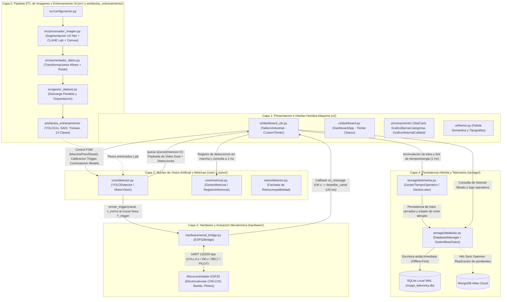

# Estado del Arte del Proyecto - V1 (Fuente de Verdad Tecnica)

**Proyecto:** Sistema Mecatronico e Inteligencia Artificial para Clasificacion Optica de Granos de Cafe y Transformacion de Datasets (MOPPI)  
**Version de Arquitectura:** 1.7.7  
**Fecha de Emision:** Octubre 2026  
**Clasificacion del Documento:** Fuente Unica de Verdad (Single Source of Truth - SSoT) de Ingenieria de Software, Vision Artificial, Mecatronica y Datos.

---

## Tabla de Contenidos

1. [Introduccion y Proposito del Documento](#1-introduccion-y-proposito-del-documento)
2. [Arquitectura General del Sistema y Finalidad de Cada Capa](#2-arquitectura-general-del-sistema-y-finalidad-de-cada-capa)
   - 2.1. Diagrama Arquitectonico Global
   - 2.2. Capa 1: Presentacion e Interfaz Hombre-Maquina (HMI Industrial)
   - 2.3. Capa 2: Nucleo de Vision Artificial, Inferencia Dual y Metricas Operativas (`core/` y `vision/`)
   - 2.4. Capa 3: Abstraccion de Hardware y Control Mecatronico Serial (`hardware/`)
   - 2.5. Capa 4: Persistencia Hibrida Offline-First y Telemetria (`storage/`)
   - 2.6. Capa 5: Ingenieria de Datos, Preprocesamiento Optico y Entrenamiento IA (`src/` y `artefactos_entrenamiento/`)
   - 2.7. Capa 6: Suite de Verificacion, Validacion y Pruebas Automatizadas (`tests/`)
3. [Interfaces de Comunicacion Inter-Capa y Contratos de Datos](#3-interfaces-de-comunicacion-inter-capa-y-contratos-de-datos)
   - 3.1. Interfaz Productor-Consumidor entre `core/detector.py` y `ui/dashboard_ctk.py`
   - 3.2. Contrato de Deteccion Individual (`Dict[str, Any]`)
   - 3.3. Protocolo Serial ASCII Bidireccional PC-ESP32 (`hardware/serial_bridge.py`)
   - 3.4. Interfaz de Eventos Asincronos Hardware-a-HMI (Thread-Safe Callbacks)
   - 3.5. Contratos de Persistencia Local (SQLite WAL) y Nube (MongoDB Atlas)
4. [Patrones de Diseno Aplicados por Capa](#4-patrones-de-diseno-aplicados-por-capa)
   - 4.1. Patron Productor-Consumidor con Descarte en Tiempo Real (Leaky Queue)
   - 4.2. Patron Maquina de Estados Finitos (FSM) con Enclavamiento de Seguridad
   - 4.3. Patron Maestro-Esclavo (Master-Slave) con Ventana Temporal en Vision Dual
   - 4.4. Patron Estrategia (Strategy) en Conmutacion Dinamica de Modelos e Inferencia SAHI
   - 4.5. Patron Repositorio Hibrido Offline-First con Cola de Sincronizacion Diferida
   - 4.6. Patron Observador (Observer / Callback) y Desacoplamiento por Inyeccion de Dependencias
   - 4.7. Patron Fachada (Facade) para Retrocompatibilidad Arquitectonica
5. [Revision Exhaustiva Modulo por Modulo: Capa `core/` y `vision/`](#5-revision-exhaustiva-modulo-por-modulo-capa-core-y-vision)
   - 5.1. `core/__init__.py`
   - 5.2. `core/detector.py`
   - 5.3. `core/metricas.py`
   - 5.4. `vision/__init__.py`
   - 5.5. `vision/detector.py`
6. [Revision Exhaustiva Modulo por Modulo: Capa `ui/`](#6-revision-exhaustiva-modulo-por-modulo-capa-ui)
   - 6.1. `ui/__init__.py`
   - 6.2. `ui/theme.py`
   - 6.3. `ui/components/__init__.py`
   - 6.4. `ui/components/stat_card.py`
   - 6.5. `ui/components/charts.py`
   - 6.6. `ui/dashboard.py`
   - 6.7. `ui/dashboard_ctk.py`
7. [Revision Exhaustiva Modulo por Modulo: Capa `hardware/` y `storage/`](#7-revision-exhaustiva-modulo-por-modulo-capa-hardware-y-storage)
   - 7.1. `hardware/__init__.py`
   - 7.2. `hardware/serial_bridge.py`
   - 7.3. `storage/__init__.py`
   - 7.4. `storage/database.py`
   - 7.5. `storage/telemetria.py`
8. [Revision Exhaustiva Modulo por Modulo: Puntos de Entrada y Prototipos en Raiz](#8-revision-exhaustiva-modulo-por-modulo-puntos-de-entrada-y-prototipos-en-raiz)
   - 8.1. `main_dashboard.py`
   - 8.2. `hmi.py`
   - 8.3. `hmi_2.py`
   - 8.4. `principal.py`
   - 8.5. `pruebas_unitarias.py`
9. [Revision Exhaustiva Modulo por Modulo: Capa `src/` y `artefactos_entrenamiento/`](#9-revision-exhaustiva-modulo-por-modulo-capa-src-y-artefactos_entrenamiento)
   - 9.1. `src/__init__.py`
   - 9.2. `src/configuracion.py`
   - 9.3. `src/procesador_imagen.py`
   - 9.4. `src/aumentador_datos.py`
   - 9.5. `src/gestor_dataset.py`
   - 9.6. `artefactos_entrenamiento/actualizar_etiqueta_y_reprocesar.py`
   - 9.7. `artefactos_entrenamiento/entrenar_yolo11s.py`
   - 9.8. `artefactos_entrenamiento/generar_dataset_800px.py`
   - 9.9. `artefactos_entrenamiento/generar_dataset_binario.py`
   - 9.10. `artefactos_entrenamiento/generar_dataset_triclase.py`
   - 9.11. `artefactos_entrenamiento/generar_graficos_ulsa.py`
10. [Revision Exhaustiva Modulo por Modulo: Capa `tests/`](#10-revision-exhaustiva-modulo-por-modulo-capa-tests)
    - 10.1 a 10.17. Analisis individual de los 17 modulos de prueba

---

## 1. Introduccion y Proposito del Documento

Este documento constituye la referencia normativa y fuente de verdad tecnica del repositorio `transformaciones_granos` del proyecto MOPPI. Su objetivo es documentar con rigor de ingenieria la totalidad del sistema en su estado actual (v1.7.7), abarcando tanto la plataforma en tiempo real de clasificacion optica e inspeccion industrial de granos de cafe (`Coffea arabica` y `Coffea canephora` / Robusta), como el pipeline offline de preprocesamiento de imagenes, aumentacion sintetica con recorte de fondo (rembg/CLAHE) y entrenamiento de redes neuronales convolucionales profundas basadas en la familia de arquitecturas YOLO11.

Cada capa arquitectonica, interfaz de comunicacion concurrente, patron de diseno, archivo `.py`, libreria importada, clase, metodo y formula matematica o cinematica se encuentra especificado en este documento para garantizar mantenibilidad, trazabilidad y auditabilidad completa del software.

---

## 2. Arquitectura General del Sistema y Finalidad de Cada Capa

El sistema se estructura bajo una **Arquitectura Modular en Capas Desacopladas Orientada a Eventos y Flujos Concurrentes**. El diseno separa estrictamente el bucle de interfaz grafica (hilo principal de Tkinter/CustomTkinter), el bucle de adquisicion e inferencia neuronal en tiempo real (hilo daemon productor), el puente de comunicacion serie con el microcontrolador ESP32 (hilos de escucha y despacho UART), y el motor de persistencia transaccional (hilo de sincronizacion diferida hacia la nube).

### 2.1. Diagrama Arquitectonico Global



### 2.2. Capa 1: Presentacion e Interfaz Hombre-Maquina (HMI Industrial)
Ubicada en el paquete `ui/` (`ui/dashboard_ctk.py`, `ui/dashboard.py`, `ui/theme.py`, `ui/components/stat_card.py`, `ui/components/charts.py`).
- **Finalidad**: Proporcionar al operador de planta una interfaz tactil de grado industrial (1280x800 px), dividida en tres vistas operativas conmutables sin recreacion de widgets (**Dashboard**, **Analiticas** y **Registros**).
- **Responsabilidades clave**:
  - Renderizar en tiempo real (aprox. 30 FPS) el flujo de video anotado de 640x640 px proveniente de la camara activa (Superior/Maestro o Inferior/Esclavo) sin bloquear el hilo de eventos de Tkinter.
  - Gobernar la **Maquina de Estados Finitos (FSM)** de la botoneria fisica/tactil (`M` Marcha, `P` Paro, `R` Reset) con enclavamientos de seguridad ante cortes abruptos de energia y verificacion previa de disponibilidad fisica de camaras mediante el modal `VentanaAdvertenciaCamaras`.
  - Permitir la calibracion cinematica de la linea de disparo (`Y_trigger`) en funcion de la latencia de la electrovalvula neumatica (0.0 a 25.0 ms) con previsualizacion en vivo e inhibicion estricta cuando la maquina esta en estado `EN_MARCHA`, exigiendo confirmacion mediante el modal `VentanaConfirmacionTrigger`.
  - Visualizar indicadores luminosos pasivos de los 4 canales de clasificacion (0, 1, 2, 3) que destellan en verde brillante durante 120 ms al recibir confirmacion fisica del microcontrolador.
  - Presentar en la vista de **Analiticas** cuatro tarjetas KPI (`StatCard`: Total Procesados, Calidad Sano %, Defectos Criticos y Rendimiento/Latencia) y un grafico de barras horizontales embebido en Matplotlib (`FigureCanvasTkAgg`) con las 13 categorias granulometricas/fitosanitarias o las 3 categorias del modelo campeon usando acronimos estructurados (`A_AGR`, `A_BRO`, `A_BUE`, ..., `R_QUE`, `G_DEF`).
  - Ofrecer en la vista de **Registros** una tabla paginada/filtrable de lotes historicos (por rango temporal y por arquitectura de modelo), controles de exportacion CSV y una consola de logs con codigo de colores por severidad (`[INFO]`, `[WARN]`, `[ERROR]`, `[ALARM]`, `[SERIAL]`).

### 2.3. Capa 2: Nucleo de Vision Artificial, Inferencia Dual y Metricas Operativas (`core/` y `vision/`)
Ubicada en `core/detector.py`, `core/metricas.py` y el paquete fachada `vision/detector.py`.
- **Finalidad**: Ejecutar de forma asincrona y determinista la captura de video dual, la inferencia neuronal profunda (YOLO11 estandar o asistida por SAHI - *Slicing Aided Hyper Inference*), el seguimiento espacial de granos con deduplicacion por cruce de linea y la toma de decision Maestro-Esclavo para el disparo neumatico.
- **Responsabilidades clave**:
  - Gestionar dos fuentes de captura de video concurrentes (`cap_top` como Camara Superior Maestro y `cap_bottom` como Camara Inferior Esclavo), verificando su autenticidad mediante analisis de varianza inter-fotograma (`_probar_stream_real`) para descartar drivers virtuales inactivos.
  - Soportar conmutacion en caliente (Hot-Swap) protegida por `threading.RLock` entre el **Modelo Campeon Tri-clase** (3 salidas: `Arabica_Bueno`, `Robusta_Bueno`, `Grano_Defecto`) y el **Modelo Exhaustivo de 13 Clases** (8 clases de *Coffea arabica* y 5 clases de *Coffea canephora*), tanto en modo directo como con particionamiento deslizante SAHI (sub-imagenes de 320x320 px con solapamiento del 20%).
  - Resolver la cinematica de caida o transporte en banda convirtiendo la latencia de respuesta del actuador neumatico ($t_{\text{actuador}} \in [0, 25]\text{ ms}$) en una coordenada vertical de disparo en pixeles ($Y_{\text{trigger}} \in [480, 640]\text{ px}$).
  - Aplicar la logica **Maestro-Esclavo**: la camara inferior (Esclavo) inspecciona el reverso del grano y, si detecta un defecto, almacena una alerta en una ventana temporal de 350 ms; cuando el grano en la camara superior (Maestro) cruza la linea $Y_{\text{trigger}}$, el sistema combina el veredicto de ambas caras (priorizando el descarte al Canal 3 si cualquiera de las dos caras presenta defecto).
  - Calcular y mantener en `core/metricas.py` (`GestorMetricas`) contadores thread-safe en memoria, porcentajes de calidad, tasas de granos por minuto/segundo y ventanas deslizantes (`collections.deque`) de FPS y latencia.

### 2.4. Capa 3: Abstraccion de Hardware y Control Mecatronico Serial (`hardware/`)
Ubicada en `hardware/serial_bridge.py`.
- **Finalidad**: Aislar toda la complejidad del protocolo fisico RS-232/UART sobre USB (PySerial) hacia el microcontrolador ESP32, garantizando que el sistema pueda operar tanto conectado a la maquina clasificadora real como en **Modo Simulacion (Mock)** transparente cuando el hardware no esta presente.
- **Responsabilidades clave**:
  - Autodetectar puertos COM disponibles filtrando chips puente USB-Serial industriales (`CP210`, `CH340`, `FTDI`, `ESP32`, `USB Serial`).
  - Transmitir tramas de disparo `CH:<canal>,X:<x_norm>\n`, comandos de traccion de banda transportadora (`BELT:RUN\n`, `BELT:STOP\n`) y comandos de columna luminosa de senalizacion (`PILOT:GREEN\n`, `PILOT:YELLOW\n`, `PILOT:RED\n`, `PILOT:WHITE\n`).
  - Ejecutar un hilo daemon de escucha continua (`_bucle_lectura`) y un hilo de reconexion automatica (`_bucle_reconexion`), despachando las respuestas del microcontrolador (como `OK:<canal>`) hacia la HMI y la base de datos de logs mediante callbacks.

### 2.5. Capa 4: Persistencia Hibrida Offline-First y Telemetria (`storage/`)
Ubicada en `storage/database.py` y `storage/telemetria.py`.
- **Finalidad**: Garantizar cero perdida de datos operativos en entornos agroindustriales con conectividad a Internet inestable o intermitente, registrando telemetria energetica, tiempos de operacion, recuperacion ante apagones y lotes de produccion.
- **Responsabilidades clave**:
  - Implementar en `DatabaseManager` una base de datos relacional local SQLite configurada en modo **WAL (`PRAGMA journal_mode=WAL;`)** con tres tablas fundamentales: `inferencias` (telemetria granular), `lotes` (resumen consolidado por corrida productiva) y `logs_operativos` (bitacora de auditoria y alarmas).
  - Ejecutar un hilo daemon en segundo plano (`_bucle_sincronizacion`) que verifica periodicamente la conexion a **MongoDB Atlas** y replica en lotes (`insert_many` / `insert_one`) todos los registros marcados con `sincronizado = 0`, actualizando su bandera a `sincronizado = 1` tras el acuse de recibo de la nube.
  - Monitorear en `GestorTiempoOperativo` el tiempo acumulado de trabajo, el consumo energetico estimado en kWh ($P_{\text{nominal}} = 450\text{ W}$) y el estado operativo persistido en disco (`estado_operativo.json`) para detectar **cortes abruptos de energia** si la aplicacion se cerro mientras el estado era `EN_MARCHA`.
  - Consolidar en `GestorLotes` los conteos por clase, FPS promedio y latencia promedio durante un ciclo de clasificacion y persistirlos atomicamente al finalizar el lote (boton `R` en estado `PARO`).

### 2.6. Capa 5: Ingenieria de Datos, Preprocesamiento Optico y Entrenamiento IA (`src/` y `artefactos_entrenamiento/`)
Ubicada en `src/configuracion.py`, `src/procesador_imagen.py`, `src/aumentador_datos.py`, `src/gestor_dataset.py` y el directorio `artefactos_entrenamiento/`.
- **Finalidad**: Transformar fotografias crudas de granos de cafe en datasets normalizados, segmentados sin fondo, mejorados cromaticamente y balanceados estadisticamente para entrenar modelos YOLO11 de alta precision.
- **Responsabilidades clave**:
  - Descargar datasets desde Google Drive de forma resiliente y multihilo (`ThreadPoolExecutor`).
  - Eliminar el fondo de cada grano mediante redes profundas de saliencia (`rembg` / U2-Net), aplicar ecualizacion adaptativa de histograma limitada por contraste (**CLAHE**) exclusivamente sobre el canal de luminancia $L^*$ del espacio perceptual **CIE $L^*a^*b^*$** (preservando intacta la cromaticidad $a^*, b^*$ vital para distinguir defectos como grano agrio, inmaduro o negro), y encuadrar el grano con *aspect-ratio* preservado sobre un lienzo cuadrado negro (`0, 0, 0`).
  - Generar aumentaciones sinteticas controladas (rotaciones matriciales de $\pm 15^\circ$, escalado isotropico, variacion de brillo/contraste y ruido gaussiano $\sigma = 10$ enmascarado solo sobre los pixeles del grano para mantener el fondo perfectamente negro).
  - Orquestar en `artefactos_entrenamiento/` la conversion de etiquetas YOLO, el remapeo entre esquemas de 13 clases, 3 clases (Tri-clase) y 2 clases (Binario), el reescalado a 800x800 px, el entrenamiento con Ultralytics YOLO11s y la generacion de graficos cientificos de desempeno.

### 2.7. Capa 6: Suite de Verificacion, Validacion y Pruebas Automatizadas (`tests/`)
Ubicada en el paquete `tests/` (17 archivos) y `pruebas_unitarias.py`.
- **Finalidad**: Verificar de forma determinista y sin necesidad de hardware fisico (mediante dobles de prueba, Mocks e imagenes sinteticas en RAM) cada invariante matematica, cinematica, espacial, transaccional y de interfaz grafica del sistema.

---

## 3. Interfaces de Comunicacion Inter-Capa y Contratos de Datos

Para evitar condiciones de carrera (*race conditions*), interbloqueos (*deadlocks*) o congelamientos de la interfaz de usuario (dado que Tkinter no es *thread-safe*), las capas se comunican exclusivamente a traves de interfaces estrictamente tipadas y mecanismos de sincronizacion explicita.

### 3.1. Interfaz Productor-Consumidor entre `core/detector.py` y `ui/dashboard_ctk.py`
El hilo de captura e inferencia (`YOLODetector._bucle_captura`) produce resultados continuamente y los deposita en `self.cola_salida`, una instancia de `queue.Queue(maxsize=2)`.
- **Politica de Contrapresion (Backpressure)**: Cuando `cola_salida` alcanza su capacidad maxima de 2 elementos, el productor extrae y descarta inmediatamente el elemento mas antiguo (`get_nowait()`) antes de insertar el nuevo (`put_nowait(payload)`). Esto garantiza que la HMI siempre renderice el fotograma con menor edad temporal (baja latencia de extremo a extremo).
- **Estructura exacta del Payload de `cola_salida`**:
```python
payload: Dict[str, Any] = {
    "frame_bgr": np.ndarray,       # Fotograma BGR (640x640x3, uint8) de la camara activa con HUD superpuesto
    "frame_top": np.ndarray,       # Fotograma BGR (640x640x3, uint8) de la Camara Superior (Maestro)
    "frame_bottom": np.ndarray,    # Fotograma BGR (640x640x3, uint8) de la Camara Inferior (Esclavo)
    "detecciones": List[Dict],     # Lista de diccionarios con cada grano detectado en el ciclo actual
    "fps": float,                  # Tasa de cuadros por segundo suavizada exponencialmente
    "latencia_ms": float,          # Tiempo combinado de inferencia neuronal (Superior + Inferior) en ms
    "y_trigger": int,              # Coordenada Y activa de disparo en pixeles
    "y_trigger_preview": Optional[int], # Coordenada Y en previsualizacion durante ajuste del slider
}
```

### 3.2. Contrato de Deteccion Individual (`Dict[str, Any]`)
Cada elemento dentro de la lista `payload["detecciones"]` (que fluye desde `YOLODetector` hacia `GestorLotes`, `GestorMetricas` y el HUD de video) cumple el siguiente contrato estructural:
```python
deteccion: Dict[str, Any] = {
    "id_grano": int,               # Identificador unico incremental asignado por el tracker centroidal
    "clase": str,                  # Nombre canonico (ej. 'Arabica_Bueno', 'Robusta_Negro', 'Grano_Defecto')
    "acronimo": str,               # Acronimo estructurado de 5 caracteres (ej. 'A_BUE', 'R_NEG', 'G_DEF')
    "confianza": float,            # Probabilidad de clasificacion asignada por el modelo [0.0, 1.0]
    "es_defecto": bool,            # True si pertenece a cualquiera de las 11 clases de defecto o 'Grano_Defecto'
    "canal": int,                  # Canal neumatico asignado: 1 (Arabica Sano), 2 (Robusta Sano), 3 (Defecto)
    "bbox": Tuple[int, int, int, int], # Caja delimitadora (x1, y1, x2, y2) en coordenadas de 640x640 px
    "centroide": Tuple[int, int],  # Coordenada (cx, cy) del centro geometrico del grano en pixeles
    "x_norm": float,               # Posicion horizontal normalizada [0.0, 1.0] respecto al ancho de banda
    "camara": str,                 # Origen de la deteccion: 'TOP' (Maestro) o 'BOTTOM' (Esclavo)
    "cruzo_trigger": bool,         # True unicamente en el fotograma exacto en que cruza Y_trigger hacia abajo
    "defecto_reverso": bool,       # True si la camara Maestro fue sobreescrita por alerta de la camara Esclavo
}
```

### 3.3. Protocolo Serial ASCII Bidireccional PC-ESP32 (`hardware/serial_bridge.py`)
La comunicacion entre `ESP32Bridge` y el firmware del microcontrolador ESP32 opera sobre UART a **115200 baudios**, formato 8N1, codificacion UTF-8 terminada por salto de linea (`\n`):
1. **Disparo de Electrovalvula (PC -> ESP32)**:
   - Formato: `CH:<canal>,X:<x_norm>\n` (ejemplo: `CH:3,X:0.45\n`).
   - Semantica: Solicita activar la electrovalvula del `<canal>` (0 a 3) alineada a la posicion transversal normalizada `<x_norm>` (2 decimales).
2. **Confirmacion de Disparo (ESP32 -> PC)**:
   - Formato: `OK:<canal>\n` (ejemplo: `OK:3`).
   - Semantica: El microcontrolador confirma que el solenoide del canal indicado fue energizado exitosamente.
3. **Control de Traccion de Banda (PC -> ESP32)**:
   - Formato: `BELT:RUN\n` (arrancar motor de banda) o `BELT:STOP\n` (detener motor de banda).
   - Respuesta esperada: `OK:BELT_RUN` o `OK:BELT_STOP`.
4. **Control de Torreta / Piloto Luminoso (PC -> ESP32)**:
   - Formato: `PILOT:<COLOR>\n`, donde `<COLOR>` pertenece a `{"WHITE", "GREEN", "YELLOW", "RED"}`.
   - Semantica: `WHITE` = Standby, `GREEN` = En Marcha, `YELLOW` = Paro Operativo, `RED` = Bloqueo de Seguridad por Corte Abrupto.

### 3.4. Interfaz de Eventos Asincronos Hardware-a-HMI (Thread-Safe Callbacks)
Cuando el hilo de lectura serial (`ESP32Bridge._bucle_lectura`) o el modo simulacion recibe una trama `OK:<canal>`, invoca el callback `on_message(linea)` inyectado por `TableroIndustrial` (`_al_recibir_respuesta_serial`).
- Dado que `_bucle_lectura` corre en un hilo secundario, `_al_recibir_respuesta_serial` verifica `threading.current_thread() is threading.main_thread()`. Si se ejecuta desde un hilo secundario, encola la actualizacion visual en el bucle de eventos de Tkinter mediante `self.after(0, lambda: self.destellar_canal(ch))`, garantizando seguridad de hilos absoluta al manipular widgets `CTkButton`.

### 3.5. Contratos de Persistencia Local (SQLite WAL) y Nube (MongoDB Atlas)
`DatabaseManager` expone metodos transaccionales protegidos por `self._db_lock = threading.Lock()` y conexiones SQLite con `check_same_thread=False` y `PRAGMA journal_mode=WAL;`.
- **Tabla `inferencias`**: `(id INTEGER PRIMARY KEY AUTOINCREMENT, timestamp TEXT, modelo TEXT, fps REAL, latencia_ms REAL, conteo_clases TEXT [JSON], total_granos INTEGER, defectos INTEGER, sincronizado INTEGER DEFAULT 0)`.
- **Tabla `lotes`**: `(id INTEGER PRIMARY KEY AUTOINCREMENT, lote_uuid TEXT UNIQUE, inicio_timestamp TEXT, fin_timestamp TEXT, duracion_segundos REAL, modelo_utilizado TEXT, modo_sahi INTEGER, total_granos INTEGER, total_arabica_bueno INTEGER, total_robusta_bueno INTEGER, total_defectos INTEGER, pureza_porcentaje REAL, conteo_clases_json TEXT, fps_promedio REAL, latencia_promedio_ms REAL, sincronizado INTEGER DEFAULT 0)`.
- **Tabla `logs_operativos`**: `(id INTEGER PRIMARY KEY AUTOINCREMENT, timestamp TEXT, nivel TEXT, origen TEXT, mensaje TEXT, sincronizado INTEGER DEFAULT 0)`.

---

## 4. Patrones de Diseno Aplicados por Capa

### 4.1. Patron Productor-Consumidor con Descarte en Tiempo Real (Leaky Queue)
- **Capas involucradas**: Capa 2 (`core/detector.py`) y Capa 1 (`ui/dashboard_ctk.py` / `ui/dashboard.py`).
- **Justificacion**: La inferencia de redes neuronales (especialmente con SAHI activado) y el renderizado GUI tienen tiempos de ciclo variables y desacoplados. El uso de una cola acotada (`maxsize=2`) con descarte del elemento mas viejo evita el crecimiento ilimitado de RAM y elimina el retraso acumulativo (*video lag*) en pantalla.

### 4.2. Patron Maquina de Estados Finitos (FSM) con Enclavamiento de Seguridad
- **Capas involucradas**: Capa 1 (`ui/dashboard_ctk.py`), Capa 3 (`hardware/serial_bridge.py`) y Capa 4 (`storage/telemetria.py`).
- **Estados definidos**:
  1. `STANDBY`: Estado de reposo seguro. Banda detenida (`BELT:STOP`), piloto blanco (`PILOT:WHITE`), boton `M` habilitado en verde, botones `P` y `R` deshabilitados, controles de calibracion de Trigger habilitados.
  2. `EN_MARCHA`: Clasificacion activa. Banda en movimiento (`BELT:RUN`), piloto verde (`PILOT:GREEN`), boton `M` deshabilitado, boton `P` habilitado en rojo, boton `R` deshabilitado, slider y botones de Trigger **estrictamente bloqueados** para impedir descalibraciones accidentales con granos en vuelo.
  3. `PARO`: Pausa operativa. Banda detenida (`BELT:STOP`), piloto amarillo (`PILOT:YELLOW`), boton `M` habilitado en **color celeste** (indicando semantica de *Reanudar* lote en curso), boton `P` deshabilitado, boton `R` habilitado en ambar (para cerrar/guardar el lote y reiniciar contadores), controles de Trigger habilitados.
  4. `BLOQUEO_SEGURIDAD`: Estado de emergencia activado al arranque si `GestorTiempoOperativo` detecta que en la sesion anterior ocurrio un corte electrico estando en `EN_MARCHA`. Banda detenida, piloto rojo (`PILOT:RED`), botones `M` y `P` bloqueados, y unicamente el boton `R` habilitado en rojo para obligar al operador a realizar una purga consciente antes de volver a `STANDBY`.

### 4.3. Patron Maestro-Esclavo (Master-Slave) con Ventana Temporal en Vision Dual
- **Capa involucrada**: Capa 2 (`core/detector.py`).
- **Justificacion**: Un grano de cafe puede lucir sano en su cara convexa superior pero presentar broca (*Hypothenemus hampei*) o fermentacion en su surco inferior. La Camara Inferior actua como **Esclavo**: no dispara valvulas por si misma, sino que registra alertas de defecto en un buffer temporal (`_buffer_defectos_esclavo`) con una validez de $\Delta t = 0.35\text{ s}$. La Camara Superior actua como **Maestro**: gobierna la posicion espacial y el instante exacto de cruce por $Y_{\text{trigger}}$, consultando el buffer del Esclavo para degradar el grano a `Grano_Defecto` (Canal 3) si el reverso presentaba dano.

### 4.4. Patron Estrategia (Strategy) en Conmutacion Dinamica de Modelos e Inferencia SAHI
- **Capa involucrada**: Capa 2 (`core/detector.py`).
- **Justificacion**: Permite intercambiar en tiempo de ejecucion cuatro estrategias de inferencia sin reiniciar las camaras ni la interfaz:
  1. Tri-clase Estandar (`yolo11s_triclase.pt` / directo).
  2. Tri-clase + SAHI (particionado en mosaicos 320x320 con NMS global).
  3. 13 Clases Estandar (`yolo11s_13clases.pt` / directo).
  4. 13 Clases + SAHI.

### 4.5. Patron Repositorio Hibrido Offline-First con Cola de Sincronizacion Diferida
- **Capa involucrada**: Capa 4 (`storage/database.py`).
- **Justificacion**: Las operaciones de escritura durante el cierre de un lote o el registro de alarmas nunca esperan por sockets de red hacia MongoDB Atlas. Todo se escribe primero en SQLite local (latencia $< 2\text{ ms}$) con `sincronizado = 0`, y el demonio `_bucle_sincronizacion` se encarga de vaciar la cola hacia la nube cuando hay red disponible.

### 4.6. Patron Observador (Observer / Callback) y Desacoplamiento por Inyeccion de Dependencias
- **Capas involucradas**: Todas (`main_dashboard.py` instancia e inyecta `DatabaseManager`, `ESP32Bridge`, `GestorMetricas`, `GestorTiempoOperativo`, `GestorLotes` y `YOLODetector` dentro de `TableroIndustrial`).
- **Justificacion**: Permite sustituir cualquier componente por un Mock en la suite de pruebas (`tests/`) sin tocar el codigo de produccion.

### 4.7. Patron Fachada (Facade) para Retrocompatibilidad Arquitectonica
- **Capas involucradas**: `vision/detector.py`, alias de clases (`MotorVision = YOLODetector`, `GestorBaseDatos = DatabaseManager`, `DashboardIndustrial = TableroIndustrial`).
- **Justificacion**: Mantiene compatibilidad total con scripts legados y pruebas unitarias de versiones previas mientras el nucleo evoluciona.

---

## 5. Revision Exhaustiva Modulo por Modulo: Capa `core/` y `vision/`

---

### 5.1. Archivo `core/__init__.py`
- **Proposito**: Inicializador del paquete `core` que expone la API publica del motor de vision artificial y de metricas operativas.
- **Librerias importadas**:
  - `from core.detector import YOLODetector, MotorVision`: Importa la clase principal del detector y su alias de compatibilidad para exponerlos en el espacio de nombres del paquete `core`.
  - `from core.metricas import GestorMetricas, RegistroInferencia`: Importa el gestor de estadisticas en tiempo real y el contenedor de datos de inferencia.
- **Variables globales**:
  - `__all__ = ["YOLODetector", "MotorVision", "GestorMetricas", "RegistroInferencia"]`: Define explicitamente los simbolos exportados al hacer `from core import *`.

---

### 5.2. Archivo `core/detector.py`
- **Proposito**: Implementar el motor central de vision artificial en tiempo real (`YOLODetector`), incluyendo captura de video dual (Maestro/Esclavo), deteccion de camaras fantasma/estaticas, inferencia con modelos YOLO11 (3 clases y 13 clases), inferencia por bloques deslizantes SAHI, seguimiento espacial por centroides, cinematica de disparo neumatico ($Y_{\text{trigger}}$), generacion sintetica de fotogramas para modo demostracion y renderizado del HUD industrial.
- **Librerias importadas y su justificacion**:
  - `os`: Verificacion de existencia de archivos de pesos `.pt` en el sistema de archivos y lectura de variables de entorno.
  - `sys`: Manipulacion de rutas y deteccion de plataforma (`sys.platform`) para elegir el backend de captura de OpenCV (`cv2.CAP_DSHOW` en Windows).
  - `time`: Medicion de alta resolucion (`time.perf_counter()`, `time.time()`) para calculo de FPS, latencia de inferencia en milisegundos, marcas de tiempo del buffer Maestro-Esclavo y pausas de hilos.
  - `math`: Calculo de distancias euclidianas (`math.hypot`) entre centroides de granos en fotogramas sucesivos para el algoritmo de tracking espacial.
  - `queue`: Implementacion de la cola thread-safe `queue.Queue(maxsize=2)` que comunica el hilo productor de vision con el hilo consumidor de la interfaz grafica.
  - `logging`: Emision de trazas estructuradas de diagnostico, advertencias de camaras y errores de carga de modelos.
  - `threading`: Creacion del hilo daemon de captura (`threading.Thread`) y sincronizacion reentrante (`threading.RLock`) durante el cambio de modelos en caliente o la calibracion de trigger.
  - `pathlib.Path`: Resolucion multiplataforma de rutas hacia los directorios de modelos (`pesos/`, `artefactos_entrenamiento/`).
  - `typing` (`Dict`, `List`, `Tuple`, `Optional`, `Any`, `Union`): Anotaciones de tipo estaticas para contratos de metodos y estructuras de datos.
  - `cv2` (OpenCV): Captura de flujos de camara (`cv2.VideoCapture`), redimensionamiento (`cv2.resize`), dibujo vectorial de cajas delimitadoras, lineas de trigger y textos del HUD (`cv2.rectangle`, `cv2.line`, `cv2.putText`, `cv2.circle`), y calculo de diferencias absolutas entre frames (`cv2.absdiff`).
  - `numpy as np`: Creacion de tensores de imagen en memoria, recortes matriciales para SAHI, operaciones vectorizadas de Non-Maximum Suppression (NMS) y generacion de imagenes sinteticas.
  - `ultralytics.YOLO` (importacion protegida con `try/except`): Carga y ejecucion de los modelos neuronales YOLO11 en PyTorch/ONNX. Si no esta instalada en un entorno de pruebas ligero, degrada limpiamente activando `_ULTRALYTICS_DISPONIBLE = False`.
  - `sahi` (`AutoDetectionModel`, `get_sliced_prediction`, importacion protegida con `try/except`): Soporte opcional para SAHI nativo; además el modulo implementa su propio motor de particionado matricial SAHI (`_inferir_con_sahi_interno`) para garantizar funcionamiento aun sin la libreria externa `sahi`.

- **Constantes y Diccionarios Globales en `core/detector.py`**:
  1. `CLASES_13: Dict[int, str]`: Mapea los indices `0..12` del modelo exhaustivo a sus nombres canonicos:
     - `0: "Arabica_Agrio"`, `1: "Arabica_Brocado"`, `2: "Arabica_Bueno"`, `3: "Arabica_Cereza"`, `4: "Arabica_Concha"`, `5: "Arabica_Inmaduro"`, `6: "Arabica_Negro"`, `7: "Arabica_Quebrado"`, `8: "Robusta_Brocado"`, `9: "Robusta_Bueno"`, `10: "Robusta_Cereza"`, `11: "Robusta_Negro"`, `12: "Robusta_Quebrado"`.
  2. `CLASES_TRICLASE: Dict[int, str]`: Mapea los indices `0..2` del modelo campeon:
     - `0: "Arabica_Bueno"`, `1: "Robusta_Bueno"`, `2: "Grano_Defecto"`.
  3. `ACRONIMOS_ESTRUCTURADOS: Dict[str, str]`: Mapea cada nombre canonico de clase a su acronimo tecnico normativo de 5 caracteres:
     - `"Arabica_Agrio": "A_AGR"`, `"Arabica_Brocado": "A_BRO"`, `"Arabica_Bueno": "A_BUE"`, `"Arabica_Cereza": "A_CER"`, `"Arabica_Concha": "A_CON"`, `"Arabica_Inmaduro": "A_INM"`, `"Arabica_Negro": "A_NEG"`, `"Arabica_Quebrado": "A_QUE"`, `"Robusta_Brocado": "R_BRO"`, `"Robusta_Bueno": "R_BUE"`, `"Robusta_Cereza": "R_CER"`, `"Robusta_Negro": "R_NEG"`, `"Robusta_Quebrado": "R_QUE"`, `"Grano_Defecto": "G_DEF"`.
  4. `COLORES_CLASE_BGR: Dict[str, Tuple[int, int, int]]`: Define los colores en espacio BGR para dibujar las cajas delimitadoras en el HUD (tonos verdes para granos sanos `Arabica_Bueno` y `Robusta_Bueno`, tonos rojos/naranjas/amarillos para defectos criticos y secundarios).
  5. Parametros fisicos y cinematicos por defecto:
     - `RESOLUCION_LIENZO = 640` (dimension cuadrada en pixeles del area de inspeccion).
     - `Y_TRIGGER_BASE_PX = 640` (borde inferior del encuadre donde se ubican las boquillas).
     - `RANGO_AJUSTE_TRIGGER_PX = 160` (rango util de anticipacion espacial vertical: de 480 px a 640 px).
     - `LATENCIA_MAX_ACTUADOR_MS = 25.0` (latencia maxima configurable en el slider para la electrovalvula).

- **Clase `YOLODetector` (y su alias `MotorVision = YOLODetector`)**:
  Representa el motor de vision artificial dual, inferencia y control de disparo. A continuacion se detallan todos sus metodos:

  1. `__init__(self, ruta_modelo: Optional[str] = None, ruta_modelo_triclase: Optional[str] = None, ruta_modelo_13clases: Optional[str] = None, fuente_video: Union[int, str] = 0, fuente_video_top: Optional[Union[int, str]] = None, fuente_video_bottom: Optional[Union[int, str]] = None, usar_13_clases: bool = False, modo_sahi: bool = False, umbral_confianza: float = 0.45, serial_bridge: Optional[Any] = None, esp32_bridge: Optional[Any] = None, metricas: Optional[Any] = None, callback_deteccion: Optional[Callable] = None, latencia_actuador_ms: float = 12.5, **kwargs)`:
     - **Funcionamiento**: Inicializa el candado reentrante `self._lock = threading.RLock()`, la cola de salida `self.cola_salida = queue.Queue(maxsize=2)`, las referencias al puente serial (`self.serial_bridge`) y a `GestorMetricas`, el estado de las dos fuentes de video (`fuente_video_top = 0`, `fuente_video_bottom = 1`), los descriptores `cap_top` y `cap_bottom`, las banderas de camara fisica abierta (`_cam_top_abierta`, `_cam_bottom_abierta`), el estado de clasificacion activa (`_clasificando`), el tracker de objetos (`_objetos_rastreados: Dict[int, Dict]`), el buffer temporal del esclavo (`_buffer_defectos_esclavo: List[Dict]`), y calcula el `y_trigger` inicial a partir de `latencia_actuador_ms` (por defecto 12.5 ms $\rightarrow Y = 560\text{ px}$). Finalmente invoca `_cargar_modelos_disponibles()`.
     - **Por que existe**: Es el constructor central que unifica la configuracion de optica, IA y cinematica, admitiendo multiples firmas de argumentos por compatibilidad con `main_dashboard.py` y los tests.

  2. `calcular_y_trigger_desde_latencia(latencia_ms: float) -> int` (Metodo estatico / de clase):
     - **Formula matematica**:
       $$L_{\text{clamped}} = \min(\max(t_{\text{ms}}, 0.0), 25.0)$$
       $$Y_{\text{trigger}} = \text{round}\left(640 - \left(\frac{L_{\text{clamped}}}{25.0} \times 160\right)\right)$$
     - **Funcionamiento**: Convierte linealmente el tiempo de respuesta de la valvula neumatica en la coordenada vertical $Y$ (en pixeles sobre un lienzo de 640x640). Para $0.0\text{ ms}$, $Y = 640\text{ px}$; para $12.5\text{ ms}$ (50%), $Y = 560\text{ px}$; para $25.0\text{ ms}$ (100%), $Y = 480\text{ px}$.
     - **Por que existe**: Modela la anticipacion espacial necesaria para compensar el retardo electromecanico de apertura del solenoide mientras el grano avanza a velocidad constante sobre la banda.

  3. `calcular_latencia_desde_y_trigger(y_px: int) -> float` (Metodo estatico):
     - **Formula matematica**:
       $$Y_{\text{clamped}} = \min(\max(y_{\text{px}}, 480), 640)$$
       $$t_{\text{ms}} = \text{round}\left(\frac{640 - Y_{\text{clamped}}}{160.0} \times 25.0, 1\right)$$
     - **Funcionamiento**: Operacion inversa que obtiene la latencia en milisegundos correspondiente a una coordenada $Y$ en pixeles.
     - **Por que existe**: Permite sincronizar el valor inicial del slider de la HMI (en ms) cuando el detector ha sido inicializado con una coordenada en pixeles.

  4. `previsualizar_latencia_actuador(self, latencia_ms: float) -> int`:
     - **Funcionamiento**: Adquiere `self._lock`, calcula la coordenada $Y$ mediante `calcular_y_trigger_desde_latencia(latencia_ms)` y la asigna a `self.y_trigger_preview` y `self._latencia_preview_ms` sin alterar `self.y_trigger` oficial.
     - **Por que existe**: Permite que cuando el operador desliza el control de Trigger en el Dashboard, se dibuje en tiempo real una segunda linea punteada amarilla de previsualizacion en el visor de video antes de confirmar el cambio.

  5. `cancelar_previsualizacion_latencia(self) -> None`:
     - **Funcionamiento**: Bajo `self._lock`, restablece `self.y_trigger_preview = None` y `self._latencia_preview_ms = None`.
     - **Por que existe**: Limpia la linea punteada de previsualizacion en el HUD cuando el usuario pulsa el boton "Cancelar" (`X`) bajo el slider.

  6. `actualizar_latencia_actuador(self, latencia_ms: float) -> int`:
     - **Funcionamiento**: Bajo `self._lock`, calcula el nuevo $Y_{\text{trigger}}$, actualiza `self.latencia_actuador_ms` y `self.y_trigger`, y limpia `self.y_trigger_preview = None`, retornando el nuevo valor entero en pixeles.
     - **Por que existe**: Compromete en firme la nueva calibracion cinematica una vez que el operador acepta el modal `VentanaConfirmacionTrigger`.

  7. `_cargar_modelos_disponibles(self) -> None`:
     - **Funcionamiento**: Busca los archivos de pesos `.pt` para Tri-clase y 13 Clases en las rutas configuradas o rutas por defecto (`pesos/`, `artefactos_entrenamiento/`). Si `_ULTRALYTICS_DISPONIBLE` es verdadero y los archivos existen, instancia los objetos `YOLO(ruta)`. Si no existen (o en entorno de test), opera en modo heuristico/sintetico sin lanzar excepciones fatales.

  8. `cambiar_modelo(self, usar_13_clases: bool, modo_sahi: Optional[bool] = None) -> None`:
     - **Funcionamiento**: Adquiere `self._lock`, actualiza `self.usar_13_clases = bool(usar_13_clases)` y, si se especifica `modo_sahi`, actualiza `self.modo_sahi = bool(modo_sahi)`. Reinicia el diccionario de seguimiento `_objetos_rastreados` para evitar mezclar etiquetas de distinta granularidad taxonomica.
     - **Por que existe**: Implementa el patron Strategy permitiendo cambiar en caliente desde la cabecera de la HMI entre `Tri-clase`, `13 Clases`, `Tri-clase + SAHI` y `13 Clases + SAHI`.

  9. `_probar_stream_real(cap: Any) -> Tuple[bool, Optional[np.ndarray]]` (Metodo estatico):
     - **Funcionamiento**:
       1. Verifica que `cap` no sea `None` y que `cap.isOpened()` sea `True`.
       2. Si `cap` no es una instancia real de `cv2.VideoCapture` (por ejemplo, un `MagicMock` o `FakeCap` en pruebas unitarias), realiza una unica llamada `cap.read()` y valida que el frame exista y tenga `size > 0`.
       3. Si es una instancia real de `cv2.VideoCapture`, lee un primer fotograma base `frame_base` y luego realiza hasta 8 lecturas separadas por `time.sleep(0.015)` (hasta ~120 ms en total). En cada lectura calcula la diferencia absoluta media entre fotogramas:
          $$\text{diff} = \frac{1}{N} \sum_{i,j,c} |I_t(i,j,c) - I_0(i,j,c)|$$
          usando `float(np.mean(cv2.absdiff(f_actual, frame_base)))`.
       4. Si en cualquier lectura $\text{diff} > 0.0$ (existe ruido termico real del sensor CMOS), retorna inmediatamente `(True, f_actual)`.
       5. Si tras las 8 lecturas todas las imagenes son bit a bit identicas ($\text{diff} == 0.0$), diagnostica que se trata de un driver virtual inactivo o pantalla congelada (ej. `Logi Capture` sin camara fisica conectada) y retorna `(False, None)`.
     - **Por que existe**: Soluciona el falso positivo en sistemas Windows donde drivers virtuales de camara reportan `isOpened() == True` y entregan un splash screen estatico aunque no exista ninguna camara USB conectada.

  10. `_abrir_camara_individual(self, fuente: Union[int, str], rol: str = "TOP") -> Tuple[Optional[Any], bool]`:
      - **Funcionamiento**: Si `fuente` es `"demo"` o `"sintetico"`, retorna `(None, False)` para usar el generador sintetico. Si es un indice entero o ruta de video, intenta abrir `cv2.VideoCapture(fuente, cv2.CAP_DSHOW)` en Windows (con fallback a `cv2.VideoCapture(fuente)`), configura resolucion 640x640 y ejecuta `_probar_stream_real(cap)`. Si la prueba falla, libera el descriptor con `cap.release()` y registra una advertencia en consola indicando que la camara no entrega video real en vivo.
      - **Por que existe**: Centraliza la apertura segura y validada de cada camara (Superior Maestro e Inferior Esclavo).

  11. `_abrir_camaras_duales(self) -> None`:
      - **Funcionamiento**: Bajo `self._lock`, cierra cualquier descriptor abierto previo e invoca `_abrir_camara_individual` para `self.fuente_video_top` y `self.fuente_video_bottom`, actualizando `self._cam_top_abierta` y `self._cam_bottom_abierta`.

  12. `verificar_estado_camaras(self) -> Dict[str, Any]`:
      - **Funcionamiento**: Si las camaras aun no han intentado abrirse y sus fuentes son indices de hardware (`int`), invoca `_abrir_camaras_duales()`. Luego evalua cada descriptor (`cap_top` y `cap_bottom`) mediante `_probar_stream_real(cap)`. Si detecta que una camara que estaba marcada como abierta ya no entrega video real, cierra el descriptor y actualiza su bandera a `False`.
      - **Retorno**:
        ```python
        {
            "top_ok": bool,
            "bottom_ok": bool,
            "todas_ok": bool,   # top_ok and bottom_ok
            "ninguna_ok": bool  # (not top_ok) and (not bottom_ok)
        }
        ```
      - **Por que existe**: Provee a `TableroIndustrial._al_pulsar_marcha()` el diagnostico exacto del hardware optico antes de iniciar el movimiento de la banda, permitiendo desplegar el modal preventivo `VentanaAdvertenciaCamaras`.

  13. `alternar_posicion_camaras(self) -> None`:
      - **Funcionamiento**: Adquiere `self._lock` e intercambia en caliente `self.fuente_video_top <-> self.fuente_video_bottom`, `self.cap_top <-> self.cap_bottom` y `self._cam_top_abierta <-> self._cam_bottom_abierta`.
      - **Por que existe**: Permite al operador corregir desde la HMI (`Sup: Cam 0 / Inf: Cam 1` vs `Sup: Cam 1 / Inf: Cam 0`) la asignacion logica de las camaras si los puertos USB fueron enumerados en orden inverso por el sistema operativo.

  14. `iniciar(self) -> None`, `detener(self) -> None`, `iniciar_clasificacion(self) -> None`, `pausar(self) -> None`, `reanudar(self) -> None`:
      - **Funcionamiento**: Controlan el ciclo de vida del hilo daemon `_hilo_captura` (`_ejecutando`) y la bandera operativa `_clasificando` (que habilita o inhibe el envio de comandos de disparo al ESP32 y el conteo de cruces por $Y_{\text{trigger}}$).

  15. `_bucle_captura(self) -> None`:
      - **Funcionamiento**: Bucle continuo ejecutado por el hilo daemon:
        1. Lee un fotograma de `cap_top` y otro de `cap_bottom` (si una camara no esta disponible, genera un fotograma sintetico de 640x640 px con `_generar_frame_sintetico` para mantener viva la tuberia visual).
        2. Ejecuta la inferencia sobre el fotograma Inferior (Esclavo) y actualiza el buffer temporal de defectos de reverso (`_actualizar_buffer_esclavo`).
        3. Ejecuta la inferencia sobre el fotograma Superior (Maestro), aplica el rastreo de centroides (`_actualizar_tracking_y_cruces`), consulta el buffer del Esclavo al cruzar $Y_{\text{trigger}}$ y, si `_clasificando` es `True`, ordena el disparo al canal correspondiente en `serial_bridge`.
        4. Dibuja el HUD sobre ambos fotogramas (`_dibujar_hud`) e inserta el payload en `self.cola_salida`.

  16. `_ejecutar_inferencia_frame(self, frame: np.ndarray, rol_camara: str = "TOP") -> Tuple[List[Dict[str, Any]], float]`:
      - **Funcionamiento**: Mide el tiempo con `time.perf_counter()`. Selecciona el modelo activo segun `self.usar_13_clases`. Si `self.modo_sahi` es `True`, invoca `_inferir_con_sahi_interno(frame, modelo, rol_camara)`; en caso contrario, ejecuta la pasada directa `modelo.predict(frame, conf=self.umbral_confianza, verbose=False)`. Si no hay modelo `.pt` cargado, utiliza el detector heuristico/sintetico `_detectar_heuristico_o_sintetico`. Retorna la lista de detecciones normalizadas y la latencia en milisegundos.

  17. `_inferir_con_sahi_interno(self, frame: np.ndarray, modelo: Any, rol_camara: str = "TOP") -> List[Dict[str, Any]]`:
      - **Funcionamiento**: Particiona la imagen de $640 \times 640\text{ px}$ en una cuadricula de recortes (*slices*) de $320 \times 320\text{ px}$ con un solapamiento (*overlap*) del $20\%$ (paso de $256\text{ px}$), ejecuta inferencia sobre cada recorte y sobre la imagen completa, traslada las coordenadas locales $(x_1, y_1, x_2, y_2)$ al sistema global de $640 \times 640\text{ px}$ y fusiona las cajas duplicadas aplicando **Non-Maximum Suppression (`_aplicar_nms_global`)** con umbral $\text{IoU} = 0.45$.
      - **Por que existe**: Mejora drasticamente la sensibilidad para detectar defectos pequenos (como perforaciones de broca de $< 2\text{ mm}$) sin sacrificar el campo de vision completo de la banda.

  18. `_aplicar_nms_global(detecciones: List[Dict[str, Any]], iou_threshold: float = 0.45) -> List[Dict[str, Any]]`:
      - **Formula matematica**: Para dos cajas $A$ y $B$, calcula la Interseccion sobre Union:
        $$\text{IoU}(A, B) = \frac{\text{Area}(A \cap B)}{\text{Area}(A) + \text{Area}(B) - \text{Area}(A \cap B)}$$
      - **Funcionamiento**: Ordena las detecciones de mayor a menor confianza y suprime cualquier caja superpuesta cuyo $\text{IoU} \ge 0.45$ con una caja ya aceptada.

  19. `_mapear_clase_y_canal(self, cls_id: int, nombre_raw: Optional[str] = None) -> Tuple[str, str, bool, int]`:
      - **Funcionamiento**: Traduce el identificador numerico o nombre crudo de la red neuronal a la tupla `(nombre_canonico, acronimo_estructurado, es_defecto, canal_neumatico)`:
        - Si la clase es `"Arabica_Bueno"` $\rightarrow$ `("Arabica_Bueno", "A_BUE", False, 1)` (Canal 1).
        - Si la clase es `"Robusta_Bueno"` $\rightarrow$ `("Robusta_Bueno", "R_BUE", False, 2)` (Canal 2).
        - Para cualquiera de los 11 defectos especificos o `"Grano_Defecto"` $\rightarrow$ `(nombre_canonico, acronimo, True, 3)` (Canal 3 - Soplador de descarte).

  20. `_actualizar_buffer_esclavo(self, detecciones_bottom: List[Dict[str, Any]], ahora: float) -> None`:
      - **Funcionamiento**: Purga del buffer `_buffer_defectos_esclavo` todos los registros cuya edad supere `self.ventana_esclavo_s` ($0.35\text{ s}$) y agrega las nuevas detecciones de la camara inferior que tengan `es_defecto == True` junto con su coordenada horizontal normalizada `x_norm` y su clase.

  21. `_consultar_defecto_esclavo(self, x_norm: float, ahora: float) -> Optional[Dict[str, Any]]`:
      - **Funcionamiento**: Busca en `_buffer_defectos_esclavo` una alerta vigente ($t_{\text{actual}} - t_{\text{alerta}} \le 0.35\text{ s}$) cuya posicion transversal $x_{\text{norm}}$ difiera en menos de $\Delta x \le 0.25$ de la posicion del grano en la camara superior. Si la encuentra, consume la alerta y la retorna para forzar la clasificacion del grano como defecto.

  22. `_actualizar_tracking_y_cruces(self, detecciones_top: List[Dict[str, Any]]) -> List[Dict[str, Any]]`:
      - **Funcionamiento**:
        1. Asocia cada centroide $(cx, cy)$ detectado en el fotograma actual con los objetos previamente registrados en `_objetos_rastreados` buscando la distancia euclidiana minima $\sqrt{(cx - cx_{\text{prev}})^2 + (cy - cy_{\text{prev}})^2} \le 75\text{ px}$.
        2. Si encuentra correspondencia, hereda el `id_grano` y el estado `ya_contado`; si no, asigna un nuevo `id_grano` incremental.
        3. **Deteccion de cruce de linea de Trigger**: Si el grano aun no ha sido contado (`not ya_contado`) y su centroide vertical cumple $cy_{\text{prev}} < Y_{\text{trigger}} \le cy_{\text{actual}}$ (o aparece por primera vez en la banda de disparo $[Y_{\text{trigger}}, Y_{\text{trigger}} + 45\text{ px}]$), marca `cruzo_trigger = True` y `ya_contado = True`.
        4. En ese instante exacto, consulta `_consultar_defecto_esclavo(x_norm)`. Si el Esclavo reporto defecto en el reverso y el Maestro veia un grano sano, sobreescribe la deteccion con `es_defecto = True`, `canal = 3` y `defecto_reverso = True`.
        5. Si `self._clasificando` es `True` y `self.serial_bridge` esta presente, invoca `self.serial_bridge.enviar_trigger(canal=det["canal"], x_norm=det["x_norm"])`.

  23. `_dibujar_hud(self, frame: np.ndarray, detecciones: List[Dict[str, Any]], rol: str = "TOP") -> np.ndarray`:
      - **Funcionamiento**: Dibuja sobre una copia del fotograma de 640x640 px:
        - Las cajas delimitadoras coloreadas segun `COLORES_CLASE_BGR`, el centroide del grano y una etiqueta superior compacta con el **acronimo estructurado** y el porcentaje de confianza: `f"{acronimo} {int(round(conf * 100))}%"` (ej. `A_BUE 96%`, `R_BRO 88%`).
        - En la camara `TOP` (Maestro), dibuja la linea horizontal solida de disparo en `y = self.y_trigger` con la leyenda `TRIGGER Y={self.y_trigger}px ({self.latencia_actuador_ms:.1f}ms)`.
        - Si `self.y_trigger_preview` esta activo (operador moviendo el slider), dibuja una segunda linea segmentada en color amarillo brillante indicando la posicion de previsualizacion `PREVIEW Y={y_prev}px`.

---

### 5.3. Archivo `core/metricas.py`
- **Proposito**: Gestionar de manera centralizada y *thread-safe* las metricas de produccion en tiempo real durante la sesion activa (conteos por variedad y defecto, porcentaje de calidad, tasa de procesamiento en granos/minuto y granos/segundo, e historiales de FPS y latencia).
- **Librerias importadas y su justificacion**:
  - `time`: Medicion de tiempo monotono (`time.time()`) para calcular la duracion efectiva de la sesion y las tasas de flujo de granos.
  - `threading`: Uso de `threading.RLock()` para proteger las lecturas y escrituras concurrentes entre el hilo de vision y el bucle de 1 Hz de la interfaz grafica.
  - `collections.deque`: Estructura de cola de doble extremo con longitud maxima fija (`maxlen=120`) para calcular promedios moviles de FPS y latencia en milisegundos con complejidad $O(1)$ y memoria acotada.
  - `dataclasses` (`dataclass`, `field`): Definicion limpia e inmutable/estructurada de la clase de transporte `RegistroInferencia`.
  - `typing` (`Dict`, `List`, `Optional`, `Any`): Tipado estatico de los metodos y estructuras de retorno.

- **Constantes Globales en `core/metricas.py`**:
  - `CLASES_GRANOS_13: List[str]`: Lista ordenada de las 13 clases del modelo exhaustivo.
  - `CLASES_TRICLASE: List[str]`: Lista ordenada de las 3 clases del modelo campeon (`Arabica_Bueno`, `Robusta_Bueno`, `Grano_Defecto`).
  - `CLASES_SANAS = {"Arabica_Bueno", "Robusta_Bueno"}`: Conjunto de clases que computan positivamente para el indice de pureza/calidad del lote.

- **Clase `RegistroInferencia` (`@dataclass`)**:
  - **Atributos**: `timestamp: float`, `fps: float`, `latencia_ms: float`, `conteo_clases: Dict[str, int]`, `total_granos: int`, `defectos: int`.
  - **Por que existe**: Encapsula una instantanea (snapshot) de telemetria de un fotograma o ventana de inferencia para su paso hacia capas de almacenamiento o auditoria.

- **Clase `GestorMetricas`**:
  1. `__init__(self, ventana_historial: int = 120)`:
     - Inicializa `self._lock = threading.RLock()`, los diccionarios de conteo acumulado `_conteo_por_clase`, contadores escalares (`_total_procesados`, `_total_sanos`, `_total_defectos`, `_total_arabica_sano`, `_total_robusta_sano`), las colas `deque(maxlen=ventana_historial)` para `_historial_fps` y `_historial_latencia`, y las variables de cronometraje de sesion (`_inicio_sesion`, `_tiempo_acumulado_s`, `_en_sesion`).
  2. `iniciar_sesion(self) -> None` y `pausar_sesion(self) -> None`:
     - Inician o pausan el cronometro interno de sesion productiva para que el calculo de granos por minuto (`granos_por_minuto`) solo contemple el tiempo real con la banda en movimiento.
  3. `registrar_detecciones(self, detecciones: List[Dict[str, Any]], fps: float = 0.0, latencia_ms: float = 0.0) -> None`:
     - **Funcionamiento**: Adquiere `self._lock`. Registra `fps` y `latencia_ms` en sus respectivos `deque`. Filtra las detecciones recibidas tomando aquellas que acaban de cruzar la linea de disparo (`d.get("cruzo_trigger", True)`), incrementa `_conteo_por_clase[clase]`, `_total_procesados` y clasifica si suma a `_total_sanos` (cuando `clase in CLASES_SANAS` y `not d.get("es_defecto", False)`) o a `_total_defectos`.
  4. `registrar_grano_individual(self, clase: str, es_defecto: Optional[bool] = None) -> None`:
     - **Funcionamiento**: Permite registrar un grano unitario directamente por nombre de clase, infiriendo automaticamente si es defecto cuando `clase not in CLASES_SANAS`.
  5. `obtener_resumen(self) -> Dict[str, Any]` (y alias `obtener_estadisticas`):
     - **Formulas matematicas**:
       - Porcentaje de Calidad (Pureza):
         $$\text{Calidad (\%)} = \begin{cases} \frac{N_{\text{sanos}}}{N_{\text{total}}} \times 100.0 & \text{si } N_{\text{total}} > 0 \\ 100.0 & \text{si } N_{\text{total}} = 0 \end{cases}$$
       - Tasa de Flujo:
         $$\text{Granos/s} = \frac{N_{\text{total}}}{\max(\Delta t_{\text{activo}}, 0.001)}, \quad \text{Granos/min} = \text{Granos/s} \times 60.0$$
     - **Retorno**: Diccionario completo con `total_procesados`, `total_sanos`, `total_defectos`, `calidad_porcentaje`, `fps_promedio`, `latencia_promedio_ms`, `granos_por_segundo`, `granos_por_minuto`, `tiempo_activo_s` y copia de `conteo_por_clase`.
  6. `reiniciar(self) -> None`:
     - Pone a cero todos los contadores y colas de historial bajo `self._lock` cuando el operador pulsa el boton `R` (Reset) tras finalizar un lote.

---

### 5.4. Archivos `vision/__init__.py` y `vision/detector.py`
- **Proposito**: Paquete de fachada (*Facade*) que preserva la compatibilidad hacia atras con modulos y pruebas que importan `from vision.detector import YOLODetector` o `from vision import MotorVision`.
- **Librerias importadas**: Reexporta de manera transparente `YOLODetector`, `MotorVision`, `CLASES_13`, `CLASES_TRICLASE`, `ACRONIMOS_ESTRUCTURADOS`, `COLORES_CLASE_BGR` desde `core.detector`.
- **Relacion con el sistema**: Garantiza que tanto la nomenclatura original (`vision.detector`) como la nomenclatura consolidada (`core.detector`) apunten exactamente a la misma clase en memoria sin duplicacion de codigo.

---

## 6. Revision Exhaustiva Modulo por Modulo: Capa `ui/`

---

### 6.1. Archivo `ui/__init__.py`
- **Proposito**: Inicializador del paquete de interfaz grafica de usuario (`ui`). Expone las clases principales tanto de la interfaz industrial tactil en CustomTkinter (`TableroIndustrial`, `DashboardIndustrial`) como de la interfaz clasica en Tkinter/Flet (`DashboardApp`).
- **Librerias importadas**:
  - `from ui.dashboard_ctk import TableroIndustrial, DashboardIndustrial, DashboardCustomTkinter, VentanaConfirmacionTrigger, VentanaAdvertenciaCamaras`
  - `from ui.dashboard import DashboardApp`
- **Relacion con el sistema**: Permite que `main_dashboard.py` y la suite de pruebas importen de forma limpia cualquier variante del dashboard o sus ventanas modales de seguridad.

---

### 6.2. Archivo `ui/theme.py`
- **Proposito**: Centralizar los tokens de diseno visual, paletas de colores hexadecimales (modo oscuro moderno y modo claro industrial HMI), tipografias jerarquicas y funciones utilitarias de estilo para Tkinter (`ttk.Style`) y Matplotlib.
- **Librerias importadas y su justificacion**:
  - `tkinter as tk` y `from tkinter import ttk`: Aplicacion de estilos nativos a widgets `ttk.Frame`, `ttk.Label`, `ttk.Button` y `ttk.Treeview` en la interfaz clasica.
  - `typing` (`Dict`, `Any`, `Tuple`): Tipado de diccionarios de colores y tuplas de fuentes `(familia, tamano, peso)`.
- **Constantes Globales Definidas**:
  - `COLORES: Dict[str, str]`: Diccionario de paleta semantica con superficies (`fondo_principal: "#0F172A"`, `fondo_secundario: "#1E293B"`, `fondo_tarjeta: "#1E293B"`, `borde: "#334155"`), textos (`texto_primario: "#F8FAFC"`, `texto_secundario: "#94A3B8"`, `texto_apagado: "#64748B"`), acentos de estado (`acento_primario: "#3B82F6"`, `exito: "#10B981"`, `advertencia: "#F59E0B"`, `peligro: "#EF4444"`, `info: "#06B6D4"`) y colores especificos por variedad (`arabica_sano: "#10B981"`, `robusta_sano: "#06B6D4"`, `defecto_critico: "#EF4444"`, `defecto_secundario: "#F59E0B"`).
  - `FUENTES: Dict[str, Tuple[str, int, str]]`: Define la escala tipografica basada en `Segoe UI` y `Consolas` (`titulo_grande`, `titulo_seccion`, `subtitulo`, `cuerpo`, `cuerpo_bold`, `kpi_valor`, `kpi_etiqueta`, `monoespaciada`, `monoespaciada_pequena`).
  - `DIMENSIONES: Dict[str, int]`: Parametros geometricos de espaciado (`padding_general = 16`, `padding_tarjeta = 12`, `radio_borde = 8`, `alto_cabecera = 60`).
- **Funciones Definidas**:
  1. `aplicar_tema_ttk(root: tk.Misc) -> ttk.Style`:
     - Configura el tema `"clam"` de `ttk.Style`, asignando colores de fondo, texto, cabeceras de tablas (`Treeview.Heading`) y filas seleccionadas para que armonicen con `COLORES`.
  2. `obtener_color_clase(nombre_clase: str) -> str`:
     - Devuelve el color hexadecimal correspondiente a una clase de grano (`#10B981` para `Arabica_Bueno`, `#06B6D4` para `Robusta_Bueno`, `#EF4444` para defectos criticos como `Negro`, `Cereza`, `Agrio`, `Brocado`, y `#F59E0B` para defectos fisicos/morfologicos como `Concha`, `Inmaduro`, `Quebrado`).
  3. `configurar_estilo_matplotlib() -> Dict[str, Any]`:
     - Retorna un diccionario de parametros compatible con `matplotlib.rcParams` para estilizar ejes, grillas y textos de graficas cientificas e industriales.

---

### 6.3. Archivo `ui/components/__init__.py`
- **Proposito**: Inicializador del subpaquete `ui.components` que agrupa los widgets reutilizables de visualizacion de KPIs y graficas estadisticas.
- **Librerias importadas**:
  - `from ui.components.stat_card import StatCard`
  - `from ui.components.charts import GraficoBarrasCategorias, GraficoHistorialCalidad`
- **Variables globales**: `__all__ = ["StatCard", "GraficoBarrasCategorias", "GraficoHistorialCalidad"]`.

---

### 6.4. Archivo `ui/components/stat_card.py`
- **Proposito**: Implementar el componente visual reutilizable `StatCard` (tarjeta de indicador clave de desempeno - KPI) capaz de mostrar un titulo descriptivo, un valor numerico principal de gran tamano, un subtitulo o unidad secundaria y una barra lateral o borde de acento cromatico.
- **Librerias importadas y su justificacion**:
  - `tkinter as tk`:Herencia de `tk.Frame` para compatibilidad universal tanto dentro de contenedores Tkinter estandar como dentro de marcos CustomTkinter.
  - `typing.Optional`: Tipado de parametros opcionales como subtitulo o color de acento.
  - `from ui.theme import COLORES, FUENTES`: Consumo de la paleta y tipografias institucionales.
- **Clase `StatCard(tk.Frame)`**:
  1. `__init__(self, parent: tk.Misc, titulo: str, valor_inicial: str = "0", subtitulo: str = "", color_acento: Optional[str] = None, **kwargs)`:
     - Construye un contenedor con borde sutil, una franja vertical izquierda de 4 px pintada con `color_acento`, la etiqueta superior `self.lbl_titulo`, la etiqueta central de alto impacto `self.lbl_valor` y la etiqueta inferior `self.lbl_subtitulo`.
  2. `actualizar(self, valor: str, subtitulo: Optional[str] = None, color_valor: Optional[str] = None) -> None`:
     - Actualiza en tiempo constante $O(1)$ el texto de `self.lbl_valor` (y opcionalmente `self.lbl_subtitulo` y el color del texto) sin destruir ni reconstruir el widget en el arbol DOM de Tkinter, evitando parpadeos (*flickering*) durante el refresco de 1 Hz.

---

### 6.5. Archivo `ui/components/charts.py`
- **Proposito**: Proveer componentes de graficacion cientifica embebidos en Tkinter mediante el backend `FigureCanvasTkAgg` de Matplotlib, libres de fugas de memoria por figuras huerfanas (`pyplot`).
- **Librerias importadas y su justificacion**:
  - `tkinter as tk`: Contenedor `tk.Frame` donde se empaqueta el lienzo de Matplotlib.
  - `typing` (`Dict`, `List`, `Optional`): Tipado de series de datos.
  - `matplotlib.figure.Figure`: Instanciacion directa orientada a objetos de la figura de Matplotlib (evitando `plt.figure()` que retiene referencias globales en RAM).
  - `matplotlib.ticker.MaxNLocator`: Forzado estricto de marcas de graduacion (*ticks*) exclusivamente en numeros enteros (`integer=True`) sobre el eje de conteo de granos.
  - `matplotlib.backends.backend_tkagg.FigureCanvasTkAgg`: Puente de renderizado de buffers RGBA de Matplotlib hacia un `tk.Canvas`.
  - `from ui.theme import COLORES, obtener_color_clase`: Consistencia cromatica entre las barras del grafico y el resto de la interfaz.
- **Clases Definidas**:
  1. `GraficoBarrasCategorias(tk.Frame)`:
     - `__init__(self, parent: tk.Misc, titulo: str = "Distribucion por Clase", **kwargs)`: Crea `self.fig = Figure(figsize=(5.5, 3.8), dpi=100)`, `self.ax = self.fig.add_subplot(111)` y `self.canvas = FigureCanvasTkAgg(self.fig, master=self)`. Configura el localizador entero `self.ax.xaxis.set_major_locator(MaxNLocator(integer=True))`.
     - `actualizar_datos(self, conteo_clases: Dict[str, int], usar_acronimos: bool = True) -> None`: Limpia el eje (`self.ax.clear()`), traduce los nombres de clase a sus acronimos estructurados (`A_AGR`, `A_BUE`, `R_BUE`, `G_DEF`, etc.), dibuja barras horizontales (`ax.barh`), fija el limite inferior del eje X estrictamente en cero (`self.ax.set_xlim(left=0, right=max(max_val * 1.18, 5))`), re-aplica `MaxNLocator(integer=True)`, anota el valor entero al final de cada barra y ejecuta `self.canvas.draw_idle()`.
  2. `GraficoHistorialCalidad(tk.Frame)`:
     - `__init__(self, parent: tk.Misc, max_puntos: int = 60, **kwargs)`: Inicializa una figura de evolucion temporal para graficar la curva de pureza (%) y FPS a lo largo del tiempo.
     - `agregar_punto(self, calidad_pct: float, fps: float) -> None`: Agrega un nuevo punto a las colas internas y redibuja la linea de tendencia en el rango $[0, 100]\%$.
     - `limpiar(self) -> None`: Vacía las series temporales al reiniciar un lote.

---

### 6.6. Archivo `ui/dashboard.py`
- **Proposito**: Implementar las interfaces alternativas/clasicas del sistema (`DashboardApp` sobre Tkinter estandar y `InterfazClasificadora` para el modo opcional `--flet`), manteniendo compatibilidad con entornos donde no se requiera CustomTkinter.
- **Librerias importadas y su justificacion**:
  - `os`, `sys`, `time`, `queue`, `logging`, `threading`: Gestion de hilos, lectura no bloqueante de `cola_salida` y control de tiempos.
  - `tkinter as tk`, `from tkinter import ttk, messagebox, filedialog`: Widgets estandar de escritorio y dialogos de exportacion de archivos.
  - `cv2`, `numpy as np`, `PIL.Image`, `PIL.ImageTk`: Conversion de fotogramas BGR de OpenCV a objetos `PhotoImage` renderizables en un `tk.Label`.
  - `from ui.theme import COLORES, FUENTES, aplicar_tema_ttk`: Estilizado visual oscuro.
  - `from ui.components.stat_card import StatCard` y `from ui.components.charts import GraficoBarrasCategorias, GraficoHistorialCalidad`: Componentes de visualizacion estadistica.
- **Clases Principales**:
  - `DashboardApp(tk.Tk)`: Ventana clasica que integra el visor de video de 640x640 px, barra lateral de controles de marcha/paro, selector de modelo (Tri-clase / 13 Clases / SAHI), grilla de `StatCard` y graficos `GraficoBarrasCategorias` y `GraficoHistorialCalidad`, actualizados mediante un bucle `self.after(33, self._actualizar_ui)`.
  - `InterfazClasificadora`: Adaptador para renderizar el flujo de video codificado en Base64 y los indicadores de telemetria cuando la aplicacion se invoca con el flag `--flet`.

---

### 6.7. Archivo `ui/dashboard_ctk.py`
- **Proposito**: Es el modulo principal de **Interfaz Hombre-Maquina (HMI) Industrial v1.7.7** ejecutado por defecto en produccion (`TableroIndustrial` / `DashboardCustomTkinter`). Implementa fielmente la arquitectura visual de `hmi.py` enriquecida con la logica completa de control de maquina (FSM), verificacion preventiva de camaras reales, calibracion cinematica de trigger en milisegundos con previsualizacion en vivo, graficas de Matplotlib de alta densidad sin valores negativos ni decimales, y gestion integral de registros e historial SQLite/MongoDB.
- **Librerias importadas y su justificacion**:
  - `os`, `sys`, `csv`, `json`, `time`, `queue`, `logging`, `threading`: Operaciones de sistema, exportacion de reportes CSV, lectura de colas de video, sincronizacion de hilos y deteccion de entorno de pruebas (`"unittest" in sys.modules`).
  - `datetime` (`datetime`, `timedelta`): Formateo de fechas y filtrado temporal de lotes.
  - `typing` (`Dict`, `List`, `Optional`, `Any`, `Callable`, `Tuple`): Contratos de tipos en todos los metodos.
  - `tkinter as tk` y `from tkinter import messagebox, filedialog`: Lienzo nativo `tk.Label` para el streaming de video a 30-60 FPS y cuadros de dialogo del sistema operativo.
  - `customtkinter as ctk`: Framework de interfaz grafica moderna con soporte para bordes redondeados, escalado DPI y widgets tactiles industriales (`CTk`, `CTkToplevel`, `CTkFrame`, `CTkButton`, `CTkLabel`, `CTkSlider`, `CTkSegmentedButton`, `CTkOptionMenu`, `CTkScrollableFrame`, `CTkTextbox`, `CTkSwitch`).
  - `cv2`, `numpy as np`, `PIL.Image`, `PIL.ImageTk`: Procesamiento del fotograma recibido desde `YOLODetector`, redimensionado a 640x640 px, conversion `BGR -> RGB` y empaquetado en `ImageTk.PhotoImage`.
  - `matplotlib.figure.Figure`, `matplotlib.ticker.MaxNLocator`, `matplotlib.backends.backend_tkagg.FigureCanvasTkAgg`: Motor de graficacion embebido en la pestana **Analiticas**.

- **Constantes Globales en `ui/dashboard_ctk.py`**:
  - Paleta de colores industrial (`VERDE = "#1F7A3D"`, `VERDE_HOVER = "#145A2C"`, `VERDE_CLARO = "#57A773"`, `VERDE_LED = "#35C759"`, `VERDE_TARJETA = "#CEE4D4"`, `ROJO_PARO = "#C0392B"`, `AMBAR_RESET = "#B8860B"`, `CELESTE_REANUDAR = "#1E88E5"`, `GRIS_FONDO = "#E9ECE8"`, `GRIS_PANEL = "#F7F8F7"`, `GRIS_OSCURO = "#333A35"`, etc.) y colores de estado bloqueado (`VERDE_BLOQUEADO = "#0F3D1E"`, `ROJO_BLOQUEADO = "#4A1510"`, `AMBAR_BLOQUEADO = "#3E2D03"`).
  - `ORDEN_CLASES_13: List[Tuple[str, str]]`: Lista ordenada de tuplas `(nombre_clase, acronimo_estructurado)` para las 13 clases:
    - `("Arabica_Agrio", "A_AGR")`, `("Arabica_Brocado", "A_BRO")`, `("Arabica_Bueno", "A_BUE")`, `("Arabica_Cereza", "A_CER")`, `("Arabica_Concha", "A_CON")`, `("Arabica_Inmaduro", "A_INM")`, `("Arabica_Negro", "A_NEG")`, `("Arabica_Quebrado", "A_QUE")`, `("Robusta_Brocado", "R_BRO")`, `("Robusta_Bueno", "R_BUE")`, `("Robusta_Cereza", "R_CER")`, `("Robusta_Negro", "R_NEG")`, `("Robusta_Quebrado", "R_QUE")`.
  - `ORDEN_CLASES_TRICLASE: List[Tuple[str, str]]`:
    - `("Arabica_Bueno", "A_BUE")`, `("Robusta_Bueno", "R_BUE")`, `("Grano_Defecto", "G_DEF")`.
  - `MAPA_ACRONIMOS: Dict[str, str]`: Diccionario de traduccion rapida de nombre de clase a acronimo estructurado.

- **Clases y Metodos en `ui/dashboard_ctk.py`**:

  #### 1. Clase `VentanaConfirmacionTrigger(ctk.CTkToplevel)` (Lineas 124-273)
  Modal tactil de seguridad para confirmar el cambio de calibracion cinematica de la linea de disparo (`Y_trigger`).
  - `__init__(self, parent: Any, nueva_latencia_ms: Optional[float] = None, nuevo_y_px: Optional[int] = None, porcentaje_slider: int = 50, callback_confirmar: Optional[Callable[[float, int], None]] = None, latencia_ms: Optional[float] = None, y_calculado_px: Optional[int] = None, on_confirmar: Optional[Callable[[], None]] = None)`:
    - Normaliza parametros (soportando tanto la firma de produccion como la firma simplificada de pruebas unitarias).
    - Configura una ventana modal de `560x360` px con color de fondo `GRIS_PANEL`, bloquea el redimensionamiento (`resizable(False, False)`), aplica `transient(parent)` y calcula las coordenadas del monitor o ventana padre para **centrar automaticamente el modal en pantalla**.
    - Construye un panel interno redondeado con borde `AMBAR_RESET` (2 px), titulo `"Confirmar Calibración de Trigger"` (Arial 24 bold), subtitulo explicativo y un recuadro oscuro (`GRIS_OSCURO`) con el resumen numerico:
      `f"Tiempo de Respuesta: {self.nueva_latencia_ms:.1f} ms ({porcentaje_slider}%)\nPosición Línea Y: {self.nuevo_y_px} px"`.
    - Despliega dos botones grandes de `210x58` px (`corner_radius=14`, fuente Arial 18 bold):
      - **Boton `"Cancelar"`**: Fondo **Verde (`VERDE`)** (la opcion segura que mantiene la calibracion previa sin alterar la maquina), comando `self._al_cancelar`.
      - **Boton `"Confirmar"`**: Fondo **Amarillo Mostaza (`AMBAR_RESET`)**, comando `self._al_confirmar`.
  - `_al_confirmar(self) -> None`: Libera `grab_release()`, destruye el modal y ejecuta `callback_confirmar(self.nueva_latencia_ms, self.nuevo_y_px)` y/o `on_confirmar()`.
  - `_al_cancelar(self) -> None`: Libera `grab_release()` y cierra el modal sin aplicar cambios.

  #### 2. Clase `VentanaAdvertenciaCamaras(ctk.CTkToplevel)` (Lineas 276-409)
  Modal preventivo grande y centrado que intercepta el arranque de marcha (`M`) cuando el diagnostico optico detecta que falta una o ambas camaras fisicas.
  - `__init__(self, parent: Any, estado_camaras: Dict[str, Any], on_continuar: Optional[Callable[[], None]] = None, on_cancelar: Optional[Callable[[], None]] = None)`:
    - Configura una ventana modal de `560x360` px centrada automaticamente respecto a la ventana principal (`x = parent.winfo_rootx() + (pw - 560) // 2`, `y = parent.winfo_rooty() + (ph - 360) // 2`).
    - Determina el mensaje diagnostico exacto segun `estado_camaras`:
      - Si `ninguna_ok` es `True` (o ni `top_ok` ni `bottom_ok` estan activas): `"No se ha detectado ninguna cámara dando video.\n\n¿Desea iniciar el proceso de todas formas?"`.
      - Si solo `not top_ok`: `"La cámara superior (Maestro) no se encuentra dando video.\n\n¿Desea iniciar el proceso de todas formas?"`.
      - Si solo `not bottom_ok`: `"La cámara inferior (Esclavo) no se encuentra dando video.\n\n¿Desea iniciar el proceso de todas formas?"`.
    - Despliega dos botones grandes de `210x58` px:
      - **Boton `"Cancelar"`**: En **Verde (`VERDE`)** (opcion segura que aborta el inicio de marcha y mantiene la clasificadora en `STANDBY`).
      - **Boton `"Continuar"`**: En **Amarillo Mostaza (`AMBAR_RESET`)** (permite al operador forzar el inicio de marcha en modo degradado o sintetico bajo su responsabilidad).
  - `_al_continuar(self) -> None`: Cierra el modal e invoca `self.on_continuar()` (`_ejecutar_arranque_marcha`).
  - `_al_cancelar(self) -> None`: Cierra el modal e invoca `self.on_cancelar()` si existe, dejando la maquina en `STANDBY`.

  #### 3. Clase `TableroIndustrial(ctk.CTk)` (Alias: `DashboardIndustrial`, `DashboardCustomTkinter`) (Lineas 412-2235)
  Clase maestra de la HMI industrial. Sus metodos se organizan en 7 subsistemas:

  - **Subsistema A: Inicializacion y Cabecera Contextual**
    1. `__init__(self, detector: Any, metricas: Any, db_manager: Optional[Any] = None, gestor_lotes: Optional[Any] = None, esp32_bridge: Optional[Any] = None, gestor_tiempo: Optional[Any] = None, **kwargs)`:
       - Inyecta o instancia por defecto `DatabaseManager`, `GestorTiempoOperativo`, `GestorLotes` y `ESP32Bridge`.
       - Registra el callback `self._al_recibir_respuesta_serial` en `esp32_bridge`.
       - Sincroniza la latencia inicial guardada (`_latencia_guardada_ms = float(getattr(self.detector, "latencia_actuador_ms", 12.5))`) y la coordenada `Y_trigger`.
       - Construye la barra superior (`_crear_barra_superior`), las 3 vistas (`_crear_pagina_dashboard`, `_crear_pagina_analiticas`, `_crear_pagina_registros`), los widgets ocultos de compatibilidad (`_crear_widgets_compatibilidad_tests`), selecciona `"Dashboard"`, verifica si hubo un corte electrico previo (`_verificar_corte_abrupto_al_arranque`) e inicia los dos bucles asincronos de `after()`: `_bucle_actualizacion_video` (33 ms) y `_bucle_actualizacion_analiticas` (1000 ms).
    2. `_crear_barra_superior(self)`, `_crear_bloque_izq_dashboard(self)`, `_crear_bloque_izq_analiticas(self)`, `_crear_bloque_izq_registros(self)`:
       - Construyen el selector global de vistas (`Dashboard`, `Analíticas`, `Registros`) a la derecha y los tres bloques contextuales izquierdos que conmutan segun la vista activa.
    3. `cambiar_pagina(self, nombre: str) -> None`:
       - Oculta con `grid_remove()` las vistas inactivas, muestra con `grid()` la vista seleccionada, subraya en blanco el texto del boton activo en `self.pestañas._buttons_dict` y fuerza el refresco inmediato de graficas o tablas si se ingresa a `"Analíticas"` o `"Registros"`.

  - **Subsistema B: Vista 1 - Dashboard (Visor Dual, Botoneria, Canales y Trigger)**
    4. `_crear_pagina_dashboard(self)`, `_crear_area_visualizador(self)`, `_crear_panel_control(self)`:
       - `_crear_area_visualizador`: Crea el marco de 640x640 px (`self.frame_grafico`), el `tk.Label` de video (`self.lbl_video_display`) y las insignias flotantes de `FPS`, `ms` y camara activa (`CÁMARA SUPERIOR (MAESTRO) | CONTROL DE DISPARO`).
       - `_crear_panel_control`: Construye las 3 columnas industriales:
         - Columna `BOTONERÍA`: Botones circulares `M` (140x140 px), `P` (140x140 px) y `R` (140x140 px).
         - Columna `CANALES`: 4 indicadores circulares pasivos (`0`, `1`, `2`, `3` de 80x80 px).
         - Columna `TRIGGER`: Etiqueta superior dinamica `self.lbl_valor_trigger` con texto `f"25 ms ({lat_inicial:.1f} ms)"`, slider vertical `self.slider_trigger` con rango **`from_=0.0` a `to=25.0`** (`number_of_steps=50`, posicionado automaticamente en `lat_inicial` mediante `self.slider_trigger.set(lat_inicial)`), etiqueta inferior `"0 ms"`, boton `"Cancelar"` (`X`) y boton `"Aplicar"` (`Check`).

  - **Subsistema C: Vista 2 - Analiticas (Grafico de Frecuencia/Categoria y Tarjetas KPI)**
    5. `_crear_pagina_analiticas(self)`, `_crear_area_grafico(self)`, `_crear_panel_estadisticas(self)`:
       - `_crear_area_grafico`: Crea `self.frame_grafico_analiticas` (634x619 px), empaqueta el titulo `"Frecuencia / Categoría"` con margenes compactos (`pady=(10, 2)`) y expande el contenedor `self.contenedor_canvas_mpl` con `fill="both", expand=True, padx=8, pady=(0, 8)` para aprovechar todo el espacio disponible del placeholder. Dentro de el incrusta `self.fig_analiticas = Figure(figsize=(6.2, 5.4), dpi=100, facecolor=GRIS_OSCURO)` y `self.ax_analiticas`, configurando `subplots_adjust(left=0.15, right=0.95, top=0.96, bottom=0.08)` y `MaxNLocator(integer=True)` en el eje X.
       - `_crear_panel_estadisticas`: Crea las 4 tarjetas KPI (`Tiempo Activo`, `Consumo Eléctrico`, `Granos Procesados`, `Precisión Clasificación`, `FPS / Latencia`) y los botones `"Terminar Lote"` y `"Sincronizar con Base de Datos"`.
    6. `_actualizar_grafico_reactivo(self) -> None`:
       - Obtiene el diccionario de conteos por clase del lote en curso (`gestor_lotes.conteo_crudo`) o de `metricas`.
       - Si el modelo activo es de **13 clases**, aplica el **filtro inteligente de variedad**: inspecciona las clases con conteo $> 0$; si solo hay granos Arabica, filtra las barras para mostrar las 8 clases `A_*`; si solo hay granos Robusta, muestra las 5 clases `R_*`; si hay ambas variedades o el conteo total es 0, muestra las 13 clases completas con sus acronimos estructurados (`A_AGR` a `R_QUE`).
       - Si el modelo activo es **Tri-clase**, muestra las 3 categorias (`A_BUE`, `R_BUE`, `G_DEF`).
       - Fija `self.ax_analiticas.set_xlim(left=0, right=limite_x)` y `self.ax_analiticas.xaxis.set_major_locator(MaxNLocator(integer=True))`, garantizando que **jamas aparezcan numeros negativos ni decimales** en el eje de conteo, incluso cuando todos los contadores valen 0 al iniciar un lote.

  - **Subsistema D: Vista 3 - Registros (Historial de Lotes y Consola de Logs)**
    7. `_crear_pagina_registros(self)`, `_crear_fila_filtros_historial(self)`, `_crear_tabla_historial(self)`, `_crear_fila_filtros_logs(self)`, `_crear_caja_logs(self)`:
       - Construyen los filtros por modelo (`Todos`, `Tri-clase`, `13 Clases`, `Tri-clase + SAHI`, `13 Clases + SAHI`) y por rango de fechas (`Hoy`, `Últimos 3 días`, `Última Semana`, `Todos`).
       - Cuando un filtro temporal es seleccionado en `CTkSegmentedButton`, actualiza los estilos de `_buttons_dict` para que el texto del boton activo pase a **color blanco (`"white"`)** con subrayado, maximizando el contraste sobre el fondo verde.
    8. `_poblar_tabla_historial(self) -> None`:
       - Consulta `self.db_manager.obtener_historial_lotes(filtro_tiempo=..., filtro_modelo=...)` y rellena las celdas de la tabla con Fecha, ID de Lote limpio, Granos Totales, Proporcion `GB (AR / RO)`, Pureza `%` y Duracion.

  - **Subsistema E: Maquina de Estados Finitos (FSM) y Enclavamientos**
    9. `_verificar_corte_abrupto_al_arranque(self)`, `_actualizar_fsm(self, nuevo_estado: str)`, `_ejecutar_arranque_marcha(self)`, `_al_pulsar_marcha(self)`, `_al_pulsar_paro(self)`, `_al_pulsar_reset(self)`:
       - Gobiernan las transiciones entre `STANDBY`, `EN_MARCHA`, `PARO` y `BLOQUEO_SEGURIDAD`.
       - En `_al_pulsar_marcha()`, si el estado es `STANDBY` y no se esta ejecutando dentro de `unittest`, invoca `self.detector.verificar_estado_camaras()`. Si `not estado_cam.get("todas_ok", True)`, instancia `VentanaAdvertenciaCamaras(parent=self, estado_camaras=estado_cam, on_continuar=self._ejecutar_arranque_marcha)` y detiene el arranque automatico hasta que el operador decida.

  - **Subsistema F: Canales Neumaticos y Calibracion de Trigger**
    10. `destellar_canal(self, canal: int)`, `_apagar_luz_canal(self, btn)`, `_al_recibir_respuesta_serial(self, linea: str)`:
        - Conmutan el indicador del canal disparado a `VERDE_LED` durante 120 ms cuando llega `OK:<canal>` desde el ESP32.
    11. `_al_mover_slider_trigger(self, valor: float)`, `_al_pulsar_cancelar_trigger(self)`, `_al_pulsar_aplicar_trigger(self)`, `_confirmar_calibracion_trigger(self, latencia_ms: float, y_px: Optional[int] = None)`:
        - Actualizan en vivo la etiqueta `f"25 ms ({lat_dinamica:.1f} ms)"`, envian la previsualizacion a `self.detector.previsualizar_latencia_actuador(lat_dinamica)`, despliegan `VentanaConfirmacionTrigger` y persisten el nuevo $Y_{\text{trigger}}$.

  - **Subsistema G: Bucles de Refresco en Tiempo Real y Cierre Limpio**
    12. `_bucle_actualizacion_video(self)` (cada 33 ms) y `_bucle_actualizacion_analiticas(self)` (cada 1000 ms):
        - Drenan `self.detector.cola_salida`, registran las detecciones en `gestor_lotes` y `metricas` solo si `self.estado_operativo == "EN_MARCHA"`, renderizan el fotograma 640x640 y actualizan KPIs y graficas.
    13. `_al_cerrar(self) -> None`:
        - Cancela los temporizadores `after()`, detiene el detector, cierra el puente serial y la base de datos, y destruye la ventana raiz.

---

## 7. Revision Exhaustiva Modulo por Modulo: Capa `hardware/` y `storage/`

---

### 7.1. Archivo `hardware/__init__.py`
- **Proposito**: Inicializador del paquete `hardware` que expone la clase `ESP32Bridge` como interfaz publica del subsistema mecatronico.
- **Librerias importadas**: `from hardware.serial_bridge import ESP32Bridge`.
- **Variables globales**: `__all__ = ["ESP32Bridge"]`.

---

### 7.2. Archivo `hardware/serial_bridge.py`
- **Proposito**: Implementar el puente de comunicacion serial asincrono full-duplex (`ESP32Bridge`) entre el motor de vision artificial/HMI y el microcontrolador ESP32 que gobierna las electrovalvulas neumaticas de los canales 0 a 3, el variador/motor de la banda transportadora, las luces piloto de 24V y el presostato del manifold neumatico.
- **Librerias importadas y su justificacion**:
  - `os`: Lectura de variables de entorno (`SERIAL_PORT`, `SERIAL_BAUDRATE`, `PNEUMATIC_PULSE_MS`, `SERIAL_SIMULATION_MODE`) e identificacion del sistema operativo (`os.name == "nt"` para asignar `"COM3"` en Windows o `"/dev/ttyUSB0"` en Linux).
  - `time`: Medicion de marcas de tiempo (`time.time()`) para calcular la latencia de ida y vuelta (RTT) del comando `PING`/`PONG` en milisegundos y pausas de cesion de CPU (`time.sleep(0.05)`) en el hilo receptor.
  - `queue`: Implementacion de la cola thread-safe `queue.Queue(maxsize=300)` (`_cola_envio`) para encolar tramas de actuacion en tiempo constante $O(1)$ sin bloquear jamás el hilo de inferencia de video.
  - `logging`: Registro estructurado de eventos y fallas bajo el logger `"MOPPI.Hardware"`.
  - `threading`: Creacion de los dos hilos daemon dedicados (`ESP32Bridge-Emisor` y `ESP32Bridge-Receptor`), bandera atomica de ciclo de vida (`threading.Event`) y cerrojo de exclusion mutua (`threading.Lock`) para proteger las estadisticas de disparos por canal.
  - `typing` (`Optional`, `Callable`, `Dict`, `Any`): Tipado estatico de constructores, callbacks y estadisticas.
  - `serial` y `from serial import SerialException` (importacion protegida con `try...except ImportError`): Libreria `pyserial` para comunicacion fisica UART/USB. Si no esta instalada en el entorno, degrada limpiamente definiendo `PYSERIAL_DISPONIBLE = False` y activando el modo simulacion.

- **Constantes Globales en `hardware/serial_bridge.py`**:
  - `PUERTO_DEFAULT`: `"COM3"` en Windows o `"/dev/ttyUSB0"` en POSIX (sobreescribible por `SERIAL_PORT`).
  - `BAUDRATE_DEFAULT`: `115200` baudios (`SERIAL_BAUDRATE`).
  - `PULSO_MS_DEFAULT`: `20` ms (`PNEUMATIC_PULSE_MS`).
  - `SIMULACION_DEFAULT`: Booleano derivado de `SERIAL_SIMULATION_MODE`.

- **Clase `ESP32Bridge`**:
  1. `__init__(self, puerto: Optional[str] = None, baudrate: Optional[int] = None, pulso_ms: Optional[int] = None, modo_simulacion: Optional[bool] = None, db_manager: Optional[Any] = None, callback_alarma: Optional[Callable[[str], None]] = None, callback_respuesta: Optional[Callable[[str], None]] = None) -> None`:
     - Inicializa los parametros de puerto, la cola `self._cola_envio = queue.Queue(maxsize=300)`, el evento `self._activo = threading.Event()`, el diccionario `self._stats_disparos = {0: 0, 1: 0, 2: 0, 3: 0}`, contadores de fallas de presion (`_total_fallas_presion`), latencia de ping (`_latencia_ping_ms`), estado de banda (`_banda_activa = False`), color de piloto (`_piloto_actual = "WHITE"`), y llama a `self._inicializar_puerto()`.
  2. `_inicializar_puerto(self) -> None`:
     - Si no se solicito simulacion y `PYSERIAL_DISPONIBLE` es `True`, intenta abrir `serial.Serial(port=self.puerto, baudrate=self.baudrate, timeout=0.1, write_timeout=0.1)`. Si la apertura falla (ej. cable USB desconectado), captura la excepcion, activa `self._en_simulacion = True` y registra el aviso sin abortar el programa. Finalmente activa `self._activo.set()` y lanza los hilos daemon `_worker_emisor` y `_worker_receptor`.
  3. `disparar_canal(self, canal: int) -> bool`:
     - Valida que `canal` pertenezca a `(0, 1, 2, 3)`. Incrementa `self._stats_disparos[canal] += 1` bajo `self._lock_stats`, construye la trama `"ACT:{canal}"` y la inserta sin bloqueo en `self._cola_envio.put_nowait(trama)`.
  4. `detener_todo(self) -> bool`:
     - Encola la trama de parada de emergencia `"STOP"` para desenergizar inmediatamente todas las salidas del microcontrolador.
  5. `control_banda(self, activa: bool) -> bool`:
     - Actualiza `self._banda_activa = bool(activa)` y encola `"BANDA:ON"` o `"BANDA:OFF"`. Es invocado por la FSM de `TableroIndustrial` al cambiar entre `EN_MARCHA`, `PARO` y `STANDBY`.
  6. `cambiar_piloto(self, color: str) -> bool`:
     - Normaliza el nombre del color (soportando espanol e ingles: `"ROJO"`/`"RED"`, `"VERDE"`/`"GREEN"`, `"BLANCO"`/`"WHITE"`, `"AMARILLO"`/`"YELLOW"`), actualiza `self._piloto_actual` y encola `"PILOT:{color_final}"`.
  7. `hacer_ping(self) -> bool`:
     - Guarda `self._ultimo_ping_ts = time.time()` y encola `"PING"` para medir el RTT de comunicacion con el ESP32.
  8. `esta_conectado(self) -> bool`, `esta_en_simulacion(self) -> bool`, `obtener_estadisticas(self) -> Dict[str, Any]`:
     - Métodos de consulta de estado y telemetria de actuacion.
  9. `cerrar(self) -> None` (y alias `desconectar`):
     - Limpia `self._activo.clear()`, inserta el centinela `None` en `_cola_envio` para detener limpiamente el hilo emisor y cierra el descriptor `self._serial_conn`.
  10. `_worker_emisor(self) -> None`:
      - Bucle del hilo emisor que extrae comandos de `_cola_envio`. Si opera en modo simulacion, delega a `_simular_respuesta(comando)`. Si opera en modo fisico, codifica `(comando + "\n").encode("utf-8")` y lo transmite por UART (`write()` + `flush()`), registrando cualquier error en `db_manager.registrar_log_local("WARNING", ...)`.
  11. `_worker_receptor(self) -> None`:
      - Bucle del hilo receptor que ejecuta `readline()` sobre el puerto serial, decodifica en UTF-8 y pasa cada linea a `_procesar_linea_recibida(linea)`.
  12. `_simular_respuesta(self, comando: str) -> None`:
      - Emula en software el comportamiento del firmware del ESP32 generando las respuestas `"PONG"`, `"OK:STOP"`, `"OK:BANDA_ON"`, `"OK:BANDA_OFF"`, `"OK:PILOT:..."` y `"OK:{canal}"` para `"ACT:{canal}"`.
  13. `_procesar_linea_recibida(self, linea: str) -> None`:
      - Analiza las tramas entrantes desde el microcontrolador:
        - Si comienza con `"ERR:PRESSURE_FAULT"`, incrementa `_total_fallas_presion`, registra un evento `"ALARM"` en SQLite (`db_manager.registrar_log_local`) e invoca `callback_alarma(linea)`.
        - Si es `"PONG"`, calcula `_latencia_ping_ms = (time.time() - self._ultimo_ping_ts) * 1000.0`.
        - Invoca `self.callback_respuesta(linea)` (que en `TableroIndustrial` dispara el destello verde de 120 ms del canal confirmado cuando llega `"OK:<canal>"`).

---

### 7.3. Archivo `storage/__init__.py`
- **Proposito**: Inicializador del paquete `storage` que exporta `MongoManager` (alias de `DatabaseManager`).
- **Librerias importadas**: `from storage.database import MongoManager`.
- **Variables globales**: `__all__ = ["MongoManager"]`.

---

### 7.4. Archivo `storage/database.py`
- **Proposito**: Proveer la capa de persistencia hibrida **Offline-First** (`DatabaseManager` / `MongoManager`), el motor de auditoria local estrictamente aislada (`logs_locales`), el monitor de alarmas de latencia (`verificar_alarma_valvula`) y el gestor del ciclo de vida de lotes de clasificacion (`GestorLotes`).
- **Librerias importadas y su justificacion**:
  - `os`, `time`, `json`, `logging`, `threading`: Gestion de archivos, temporizacion, serializacion JSON de conteos por clase y sincronizacion mediante `threading.RLock()`.
  - `sqlite3`: Motor de base de datos relacional embebido configurado con `PRAGMA journal_mode=WAL;` y `PRAGMA synchronous=NORMAL;` para transacciones ACID de baja latencia sin bloqueos de lectura/escritura.
  - `datetime` (`datetime`, `timedelta`): Generacion de timestamps, IDs de lote (`LOTE-YYYYMMDD-HHMMSS`) y calculo de ventanas temporales para filtros y purga automatica.
  - `contextlib.contextmanager`: Implementacion del gestor de contexto transaccional `_conectar_sqlite()`.
  - `pymongo` (`MongoClient`, `ServerSelectionTimeoutError`, `ConnectionFailure`, `PyMongoError`) y `certifi` (importacion protegida): Conexion TLS/SSL con MongoDB Atlas y manejo granular de excepciones de red.

- **Funciones y Clases en `storage/database.py`**:

  #### 1. Funcion `verificar_alarma_valvula(latencia_ms: float) -> bool`
  - Evalua si `latencia_ms > PNEUMATIC_VALVE_LATENCY_LIMIT_MS` (`35.0` ms por defecto). Si se supera el umbral fisico permitido antes de que el grano pase frente a la boquilla, registra una advertencia en el logger y persiste una alarma `"ALARM"` en la tabla `logs_locales` a traves de `DatabaseManager._instancia_activa`.

  #### 2. Clase `DatabaseManager` (Alias: `MongoManager`)
  1. `__init__(...)`: Inicializa parametros multi-tenant (`tenant_id="finca_alvizua"`, `maquina_id="moppi_01"`), crea la base SQLite en `storage/respaldo_local.db`, ejecuta `_inicializar_sqlite()`, purga registros antiguos (`purgar_datos_antiguos`), lanza un hilo daemon para conectar con MongoDB Atlas (`_conectar_mongo`) e inicia el demonio de sincronizacion periodica (`iniciar_demonio_sincronizacion(intervalo_segundos=20)`).
  2. `_conectar_sqlite(self)` (`@contextmanager`): Abre la conexion SQLite con `timeout=10.0`, activa `WAL`, entrega la conexion y ejecuta `commit()` automatico al salir del bloque `with` o `rollback()` si ocurre una excepcion.
  3. `_inicializar_sqlite(self) -> None`: Crea las tablas `lotes` (con columnas de telemetria, `modelo_activo`, `modo_sahi`, `conteo_crudo_json`, `resumen_completo_json`, `sync`, `fecha_sync` e indices optimizados) y `logs_locales` (`id`, `timestamp`, `tipo`, `mensaje`).
  4. `_conectar_mongo(self) -> bool`: Intenta conectar a MongoDB Atlas con `serverSelectionTimeoutMS=5000` y certificados `certifi.where()`, verificando la conexion con `admin.command("ping")`. Si tiene exito, dispara inmediatamente `sincronizar_pendientes()`.
  5. `guardar_lote_transaccional(self, resumen: Dict[str, Any]) -> Tuple[bool, str]` (y alias `guardar_resumen_lote`, `guardar_resumen_lote_sync`):
     - **Paso 1 (ACID Local)**: Inserta el lote en la tabla `lotes` de SQLite con `sync = 0`.
     - **Paso 2 (Subida Inmediata Opcional)**: Si `_conectado_mongo` es `True`, intenta insertar el documento en MongoDB Atlas (`insert_one`). Si Atlas confirma la insercion, actualiza el registro local a `sync = 1` y registra `fecha_sync`. Si ocurre cualquier fallo de red (`ServerSelectionTimeoutError`, `ConnectionFailure`, `PyMongoError`), captura la excepcion, marca `_conectado_mongo = False` y conserva `sync = 0` para que el demonio lo sincronice mas tarde.
  6. `guardar_resumen_lote_async(self, resumen: Dict[str, Any], callback_resultado: Optional[Callable] = None) -> None`:
     - Ejecuta `guardar_lote_transaccional` en un hilo daemon independiente para no bloquear ni un milisegundo la interfaz grafica al cerrar un lote.
  7. `sincronizar_pendientes(self) -> int`:
     - Consulta todos los lotes con `sync = 0` en SQLite, reconstruye sus diccionarios desde `resumen_completo_json` (eliminando cualquier clave `_id` incompatible) y ejecuta una insercion masiva por lotes `self._coleccion_mongo.insert_many(documentos_a_subir, ordered=False)`.
     - **Transaccionalidad estricta**: Unicamente si `insert_many` retorna `inserted_ids` sin lanzar excepcion, ejecuta `UPDATE lotes SET sync = 1, fecha_sync = ? WHERE id IN (...)` en SQLite.
  8. `iniciar_demonio_sincronizacion(self, intervalo_segundos: int = 20) -> None`:
     - Mantiene un hilo daemon que cada 20 segundos verifica la salud de la conexion a MongoDB y vacia la cola de lotes con `sync = 0`.
  9. `purgar_datos_antiguos(self, dias: Optional[int] = None) -> Dict[str, int]`:
     - Elimina lotes con antiguedad mayor a `DATA_RETENTION_DAYS` (30 dias) en SQLite y MongoDB, y purga eventos de `logs_locales` mayores a 7 dias.
  10. `obtener_historial_lotes(self, filtro_modelo: Optional[str] = None, filtro_fecha: Optional[str] = None, limite: int = 200) -> List[Dict[str, Any]]`:
      - Construye dinamicamente la consulta SQL sobre `lotes` aplicando filtros combinados:
        - **Filtro por arquitectura y SAHI**: Distingue con precision entre `"Tri-clase"` (`modelo_activo LIKE '%tri%' AND modo_sahi = 0`), `"13 Clases"` (`modelo_activo LIKE '%13%' AND modo_sahi = 0`), `"Tri-clase + SAHI"` (`modelo_activo LIKE '%tri%' AND modo_sahi = 1`), `"13 Clases + SAHI"` (`modelo_activo LIKE '%13%' AND modo_sahi = 1`) y `"Todos"`.
        - **Filtro por fecha**: `"Hoy"`, `"Últimos 3 días"`, `"Última Semana"` o `"Todos"` evaluados sobre `COALESCE(timestamp, fecha_creacion)`.
      - Calcula para cada fila la proporcion de grano bueno Arabica vs Robusta (`prop_gb_ar_ro = f"{pct_ar}% / {pct_ro}%"`) a partir de `conteo_crudo` y retorna la lista lista para poblar la tabla de la pestana **Registros**.
  11. `registrar_log_local(self, tipo: str, mensaje: str) -> None` y `obtener_logs_locales(...) -> List[Dict[str, Any]]`:
      - Gestionan la bitacora de auditoria local en la tabla `logs_locales` (normalizando niveles `"INFO"`, `"WARNING"`, `"ALARM"`), aislada por diseno para no saturar el ancho de banda hacia la nube.

  #### 3. Clase `GestorLotes`
  1. `__init__(self, db_manager: DatabaseManager, timeout_inactividad_seg: Optional[int] = None, potencia_hardware_kw: Optional[float] = None, ...)`:
     - Inicializa contadores por clase (`conteo_crudo`), conjuntos de deduplicacion de granos (`_ids_granos_procesados: set`), historiales de FPS y latencia, y arranca el hilo daemon `_bucle_monitoreo_inactividad`.
  2. `configurar_modelo(self, modelo_13_clases: bool, modo_sahi: bool) -> None`:
     - Sincroniza el esquema de conteo del lote con el modelo activo en el detector (`CLASES_13` vs `CLASES_TRI`) y registra si el modo `SAHI` esta habilitado.
  3. `iniciar_nuevo_lote(self) -> str` (y alias `iniciar_lote`):
     - Genera un nuevo identificador `LOTE-YYYYMMDD-HHMMSS`, reinicia contadores y el conjunto `_ids_granos_procesados`, marca `lote_activo = True` y escribe un log `"INFO"` en SQLite.
  4. `registrar_detecciones(self, detecciones: List[Dict[str, Any]], fps: float, latencia_ms: float) -> None`:
     - Verifica primero `verificar_alarma_valvula(latencia_ms)`.
     - Garantiza **conteo unico por grano fisico**: verifica `id_seguimiento` contra `self._ids_granos_procesados` (o la bandera `es_nuevo`) para que un mismo grano rastreado a lo largo de varios fotogramas se contabilice exactamente una vez.
     - Incrementa `total_granos`, `total_sanos`, `total_defectuosos` y la clave correspondiente en `self.conteo_crudo` segun el esquema de 13 clases o Tri-clase.
  5. `_bucle_monitoreo_inactividad(self) -> None`:
     - Comprueba cada segundo si un lote activo lleva mas de `LOT_TIMEOUT_SECONDS` (120 s) sin recibir granos; de ser asi, invoca automaticamente `finalizar_lote(motivo="timeout_inactividad")`.
  6. `finalizar_lote(self, motivo: str = "manual") -> Optional[Dict[str, Any]]`:
     - Calcula la duracion total en segundos y formato `HH:MM:SS`, el consumo electrico del lote en kWh:
       $$E_{\text{lote}} = \left(\frac{\Delta t_{\text{seg}}}{3600}\right) \times P_{\text{nominal (kW)}}$$
       la latencia media, los FPS medios y el porcentaje de calidad, y despacha la persistencia mediante `self.db_manager.guardar_resumen_lote_async(resumen_lote)`.

---

### 7.5. Archivo `storage/telemetria.py`
- **Proposito**: Administrar el tiempo acumulado de operacion diaria de la maquina clasificadora y detectar **cortes electricos abruptos o paros de emergencia en marcha** mediante persistencia atomica en JSON (`storage/estado_maquina.json`).
- **Librerias importadas y su justificacion**:
  - `os`: Operaciones de sistema de archivos, sincronizacion forzada a disco fisico (`os.fsync(f.fileno())`) y reemplazo atomico a nivel de sistema de archivos (`os.replace(ruta_tmp, self.ruta_archivo)`).
  - `json`: Serializacion y lectura del estado de la maquina.
  - `time`, `datetime`: Control de intervalos de guardado periodico (cada 60 s) y deteccion de cambio de fecha a medianoche (`%Y-%m-%d`).
  - `threading`: Cerrojo reentrante `threading.RLock()` para seguridad de hilos.

- **Clase `GestorTiempoUso` (Alias funcional en HMI: `GestorTiempoOperativo`)**:
  1. `__init__(self, ruta_archivo: Optional[str] = None, intervalo_guardado_seg: int = 60, potencia_nominal_kw: float = 0.5, **kwargs)`:
     - Inicializa atributos (`segundos_acumulados = 0`, `estado_operativo = "STANDBY"`, `requiere_reset_por_corte = False`) e invoca `self.cargar_estado()`.
  2. `cargar_estado(self) -> int`:
     - Lee `storage/estado_maquina.json`. Si `fecha` coincide con el dia actual, restaura `segundos_uso`; si es un nuevo dia, reinicia el contador diario a `0`.
     - **Invariante de Seguridad Anti-Apagones**: Si el `estado_operativo` guardado en disco al momento del ultimo apagado era `"EN_MARCHA"`, deduce que el sistema sufrio un corte de energia o cierre forzado sin pasar por `"PARO"`, por lo que activa `self.requiere_reset_por_corte = True` y fuerza `self.estado_operativo = "PARO"`, persistiendo inmediatamente el bloqueo.
  3. `guardar_estado(self) -> None`:
     - Implementa el patron **Write-Ahead Atomic File Replacement**: escribe el JSON en `estado_maquina.json.tmp`, vacia el buffer de Python (`f.flush()`), fuerza el volcado al hardware de almacenamiento (`os.fsync(f.fileno())`) y ejecuta `os.replace(ruta_tmp, self.ruta_archivo)`. Esto garantiza que un apagon en mitad de la escritura jamas corrompa el archivo JSON principal.
  4. `actualizar_estado_operativo(self, nuevo_estado: str) -> None`:
     - Actualiza `self.estado_operativo` y ejecuta `guardar_estado()` cada vez que la FSM de la HMI cambia de estado.
  5. `reset_corte_abrupto(self) -> None`:
     - Limpia `self.requiere_reset_por_corte = False`, fija `self.estado_operativo = "STANDBY"` y guarda en disco cuando el operador pulsa el boton `R` (Reset) para purgar la maquina.
  6. `tick(self, clasificacion_activa: bool) -> int`:
     - Invocado cada segundo por `_bucle_actualizacion_analiticas`. Verifica si cambio la fecha a medianoche; si `clasificacion_activa` es `True`, acumula los segundos transcurridos y realiza un guardado atomico en disco cada `intervalo_guardado_seg` (60 s).
  7. `obtener_tiempo_formateado(self) -> str`:
     - Formatea `segundos_acumulados` como cadena `"HH:MM:SS"` para la tarjeta KPI de la vista **Analiticas**.

---

## 8. Revision Exhaustiva Modulo por Modulo: Puntos de Entrada y Prototipos en Raiz

---

### 8.1. Archivo `main_dashboard.py`
- **Proposito**: Punto de entrada principal en produccion para el sistema de clasificacion optica e interfaz HMI. Actua como **Raiz de Composicion (Composition Root)** e inyector de dependencias.
- **Librerias importadas**: `os`, `sys`, `dotenv.load_dotenv`, `core.detector.YOLODetector`, `core.metricas.GestorMetricas`, `storage.database` (`DatabaseManager`, `GestorLotes`, `MongoManager`), `hardware.serial_bridge.ESP32Bridge`, e importacion condicional de `ui.dashboard_ctk.DashboardCustomTkinter` (por defecto) o `flet` + `ui.dashboard.InterfazClasificadora` (si se pasa `--flet`).
- **Funcion `main() -> None`**:
  1. Carga el archivo `.env` mediante `load_dotenv()`.
  2. Lee las variables de entorno `MODEL_PATH`, `MODEL_13CLASES_PATH`, `CAMERA_SOURCE`, `CAMERA_SOURCE_TOP`, `CAMERA_SOURCE_BOTTOM`, `HARDWARE_POWER_KW`, `CONFIDENCE_THRESHOLD` y `MONGO_URI`.
  3. Instancia en orden jerarquico: `db_manager`, `gestor_lotes`, `esp32_bridge`, `metricas` y `detector`.
  4. Inicia los hilos del detector (`detector.iniciar()`) y lanza `DashboardCustomTkinter` con `app.mainloop()`.

---

### 8.2. Archivo `hmi.py`
- **Proposito**: Maqueta estructural de referencia (*wireframe* maestro en CustomTkinter de 728 lineas) donde se definio la geometria exacta de 1280x800 px, la paleta cromatica industrial en modo claro (`VERDE = "#1F7A3D"`, `GRIS_FONDO = "#E9ECE8"`, `GRIS_OSCURO = "#333A35"`) y la disposicion de las 3 vistas (`Dashboard`, `Analíticas`, `Registros`) que posteriormente fue integrada con todos los subsistemas de backend en `ui/dashboard_ctk.py`.
- **Librerias importadas**: `customtkinter as ctk`, `tkinter as tk`.
- **Clase `InterfazApp(ctk.CTk)`**: Define los metodos de construccion visual `crear_barra_superior`, `crear_bloque_izq_dashboard`, `crear_bloque_izq_analiticas`, `crear_bloque_izq_registros`, `cambiar_pagina`, `crear_pagina_dashboard`, `crear_area_visualizador`, `crear_panel_control`, `crear_pagina_analiticas`, `crear_area_grafico`, `crear_panel_estadisticas`, `crear_pagina_registros`, `crear_fila_filtros`, `crear_tabla_historial` y `crear_caja_logs`.

---

### 8.3. Archivo `hmi_2.py`
- **Proposito**: Prototipo funcional especifico para experimentar y validar de forma aislada la Maquina de Estados Finitos (`STANDBY`, `MARCHA`, `PARO`), el bloqueo de controles durante la marcha, el destello de canales por 120 ms (`pulse_channel`) y el calculo de posicionamiento de la linea de trigger con confirmacion modal y persistencia en `storage/config_trigger.json`.
- **Librerias importadas**: `json`, `time`, `pathlib.Path`, `tkinter as tk`, `tkinter.messagebox`, `customtkinter as ctk`.
- **Clase `HMI(ctk.CTk)`**: Implementa los metodos `read_trigger`, `make_header`, `make_viewer`, `make_controls`, `refresh`, `start`, `stop`, `reset`, `swap_positions`, `toggle_camera`, `select_model`, `on_trigger`, `update_trigger_line`, `cancel_trigger`, `apply_trigger` y `pulse_channel`.

---

### 8.4. Archivo `principal.py`
- **Proposito**: Punto de entrada por linea de comandos (CLI) para ejecutar el pipeline offline de ingenieria de datos y generacion del dataset YOLO de 13 clases a 640x640 px.
- **Librerias importadas**: `from src.configuracion import Configuracion`, `from src.gestor_dataset import GestorDataset`.
- **Funcion `ejecutar() -> None`**: Instancia `Configuracion` con `tamano_objetivo=640`, `proporcion_division=(0.8, 0.1, 0.1)`, `semilla_aleatoria=42`, la inyecta en `GestorDataset` e invoca `pipeline.ejecutar_pipeline()`.

---

### 8.5. Archivo `pruebas_unitarias.py`
- **Proposito**: Suite de validacion rapida por linea de comandos para verificar las 4 capas del paquete `src/` (`Configuracion`, `ProcesadorImagen`, `AumentadorDatos` y `GestorDataset`).
- **Librerias importadas**: `os`, `shutil`, `tempfile`, `numpy as np`, `cv2`, `src.configuracion`, `src.procesador_imagen`, `src.aumentador_datos`, `src.gestor_dataset`.
- **Funciones de prueba**:
  - `probar_configuracion()`: Verifica multiplicadores de sobremuestreo y parametros base.
  - `probar_procesador_imagen()`: Verifica la invarianza dimensional de CLAHE y la exactitud matematica del recalculo de bounding boxes tras aplicar *letterbox* cuadrado sobre una imagen rectangular de 800x400 px.
  - `probar_aumentador_datos()`: Verifica la generacion de 6 variaciones con Albumentations preservando coordenadas YOLO.
  - `probar_extraccion_id_y_particionado()`: Verifica que `extraer_id_grano` unifique las vistas `"frontal"` y `"reverso"` bajo un mismo ID para impedir *Data Leakage*.
  - `probar_pipeline_completo()`: Ejecuta una prueba *end-to-end* sobre un directorio temporal con 10 granos sinteticos (20 imagenes).

---

## 9. Revision Exhaustiva Modulo por Modulo: Capa `src/` y `artefactos_entrenamiento/`

---

### 9.1. Archivo `src/__init__.py`
- **Proposito**: Inicializador del paquete de ingenieria de datos `src`. Exporta `Configuracion`, `ProcesadorImagen`, `AumentadorDatos` y `GestorDataset`.

---

### 9.2. Archivo `src/configuracion.py`
- **Proposito**: Encapsular los hiperparametros de preprocesamiento, rutas de directorios, resolucion objetivo, proporciones de particionado, mapeo biunivoco de las 13 clases y factores de sobremuestreo (*oversampling*) para balancear las clases minoritarias respecto a las mayoritarias (`Arabica_Bueno` con 372 granos y `Robusta_Bueno` con 244 granos).
- **Librerias importadas**: `from typing import Dict, Tuple, Union`.
- **Clase `Configuracion`**:
  - `__init__(self, directorio_imagenes_entrada="dataset_bruto/images", directorio_etiquetas_entrada="dataset_bruto/labels", directorio_salida="dataset_yolo", tamano_objetivo=640, proporcion_division=(0.8, 0.1, 0.1), objetivos_aumento=None, mapeo_nombres_a_ids=None, semilla_aleatoria=42)`:
    - Define `self.objetivos_aumento` con los multiplicadores calculados empiricamente: `Arabica_Agrio (0): 6`, `Arabica_Brocado (1): 5`, `Arabica_Bueno (2): 0`, `Arabica_Cereza (3): 17`, `Arabica_Concha (4): 12`, `Arabica_Inmaduro (5): 8`, `Arabica_Negro (6): 2`, `Arabica_Quebrado (7): 2`, `Robusta_Brocado (8): 1`, `Robusta_Bueno (9): 0`, `Robusta_Cereza (10): 11`, `Robusta_Negro (11): 7`, `Robusta_Quebrado (12): 6`.
    - Define `self.mapeo_nombres_a_ids` mapeando los 13 nombres canonicos a los enteros `0..12`.

---

### 9.3. Archivo `src/procesador_imagen.py`
- **Proposito**: Ejecutar las transformaciones matematicas deterministas sobre las imagenes crudas y sus cajas delimitadoras YOLO: mejora de contraste local en el espacio perceptual CIE $L^*a^*b^*$ (CLAHE) y encuadre cuadrado sin deformacion geometrica (*letterbox padding*) con transformacion afin de coordenadas.
- **Librerias importadas**: `from typing import List, Tuple, Optional`, `import cv2`, `import numpy as np`.
- **Clase `ProcesadorImagen`**:
  1. `aplicar_autocontraste(imagen: np.ndarray, limite_recorte: float = 2.0, tamano_rejilla: Tuple[int, int] = (8, 8)) -> np.ndarray` (`@staticmethod`):
     - Transforma la imagen de BGR a CIE $L^*a^*b^*$ (`cv2.COLOR_BGR2LAB`), separa los canales $(L, a, b)$, aplica `cv2.createCLAHE(clipLimit=2.0, tileGridSize=(8, 8))` exclusivamente sobre el canal de luminancia $L$, recompone los canales con `cv2.merge` y regresa a BGR. Esto realza perforaciones de broca y fisuras sin distorsionar el matiz ni la saturacion cromatica de los canales $a$ y $b$.
  2. `aplicar_relleno_y_redimensionar(imagen: np.ndarray, cajas_delimitadoras: Optional[List[List[float]]] = None, tamano_objetivo: int = 640) -> Tuple[np.ndarray, List[List[float]]]` (`@staticmethod`):
     - Sea $(H_{\text{orig}}, W_{\text{orig}})$ el tamano original y $D_{\max} = \max(H_{\text{orig}}, W_{\text{orig}})$.
     - Calcula los bordes simetricos negros (`[0, 0, 0]`) superior, inferior, izquierdo y derecho para formar un lienzo cuadrado $(D_{\max}, D_{\max}, 3)$ con `cv2.copyMakeBorder` y lo escala a `(tamano_objetivo, tamano_objetivo)` con `cv2.INTER_LINEAR`.
     - Recalcula cada caja YOLO $[x_{\text{norm}}, y_{\text{norm}}, w_{\text{norm}}, h_{\text{norm}}]$ al nuevo espacio cuadrado:
       $$x'_{\text{norm}} = \text{clip}\left(\frac{x_{\text{norm}} \cdot W_{\text{orig}} + \text{pad}_{\text{izq}}}{D_{\max}}, 0.0, 1.0\right), \quad y'_{\text{norm}} = \text{clip}\left(\frac{y_{\text{norm}} \cdot H_{\text{orig}} + \text{pad}_{\text{sup}}}{D_{\max}}, 0.0, 1.0\right)$$
       $$w'_{\text{norm}} = \text{clip}\left(\frac{w_{\text{norm}} \cdot W_{\text{orig}}}{D_{\max}}, 0.0, 1.0\right), \quad h'_{\text{norm}} = \text{clip}\left(\frac{h_{\text{norm}} \cdot H_{\text{orig}}}{D_{\max}}, 0.0, 1.0\right)$$

---

### 9.4. Archivo `src/aumentador_datos.py`
- **Proposito**: Generar variaciones sinteticas fotometricas y geometricas mediante `Albumentations`, transformando simultaneamente los pixeles y las coordenadas de las cajas delimitadoras en la particion de entrenamiento (`train`).
- **Librerias importadas**: `from typing import List, Dict, Any, Union`, `import albumentations as A`, `import numpy as np`.
- **Clase `AumentadorDatos`**:
  1. `__init__(self, probabilidad_volteo_horizontal=0.5, probabilidad_volteo_vertical=0.5, probabilidad_rotacion_90=1.0, limite_brillo=0.15, limite_contraste=0.15, probabilidad_brillo_contraste=0.5)`:
     - Construye un pipeline `A.Compose` con isometrias ortogonales en lienzo cuadrado (`HorizontalFlip`, `VerticalFlip`, `RandomRotate90`) que no introducen interpolacion destructiva ni expanden artificialmente el area de los *bounding boxes*, mas `RandomBrightnessContrast` ($\pm 15\%$), configurado con `A.BboxParams(format="yolo", label_fields=["etiquetas_clases"], min_visibility=0.0, check_each_transform=True)`.
  2. `aumentar_muestra(self, imagen: np.ndarray, cajas_delimitadoras: List[List[float]], etiquetas_clases: List[Union[int, str]], multiplicador: int) -> List[Dict[str, Any]]`:
     - Ejecuta `multiplicador` realizaciones estocasticas independientes del pipeline sobre la muestra base y devuelve la lista de diccionarios `{"imagen": ..., "cajas": ..., "etiquetas": ...}`.

---

### 9.5. Archivo `src/gestor_dataset.py`
- **Proposito**: Orquestar de principio a fin la construccion del dataset YOLO: emparejamiento con el catalogo de Label Studio, agrupacion por identidad fisica de grano/bandeja para impedir fuga de datos (*Zero Data Leakage* entre capturas frontales y reversos), preprocesamiento CLAHE + Letterbox, aumentacion balanceada y generacion de `data.yaml`.
- **Librerias importadas**: `os`, `re`, `glob`, `random`, `typing`, `cv2`, `numpy as np`, `src.configuracion`, `src.procesador_imagen`, `src.aumentador_datos`.
- **Constantes de Clase**:
  - `CATALOGO_IMAGENES_LABEL_STUDIO`: Lista ordenada de los 54 nombres base de las fotografias originales del proyecto mapeadas a las tareas `35..88` de Label Studio (34 de Arabica y 20 de Robusta).
- **Metodos de `GestorDataset`**:
  1. `__init__(self, configuracion: Configuracion)`: Almacena la configuracion e instancia `ProcesadorImagen` y `AumentadorDatos`.
  2. `extraer_id_grano(self, nombre_archivo: str) -> str`: Elimina mediante expresiones regulares los sufijos de cara fotografiada (`frontal`, `reverso`, `front`, `back`, `anverso`, `cara_a`, `cara_b`), garantizando que ambas caras del mismo conjunto fisico de granos reciban exactamente el mismo identificador de grupo.
  3. `buscar_ruta_etiqueta(self, nombre_base: str) -> str`: Resuelve el archivo `.txt` de anotaciones buscando por nombre directo o por el ID de tarea de Label Studio (`35 + indice`).
  4. `agrupar_por_id_grano(self) -> Dict[str, List[Dict[str, str]]]`: Agrupa todas las imagenes de entrada por su `id_grano` y detecta si pertenecen al subconjunto de validacion (`"valida" in nombre_base.lower()`).
  5. `dividir_dataset(self, grupos_por_id) -> Dict[str, List[Dict[str, str]]]`: Separa los grupos completos en `train`, `val` y `test` sin romper jamas un grupo entre dos particiones distintas.
  6. `leer_etiquetas_yolo(ruta_etiqueta: str)` y `guardar_etiquetas_yolo(ruta_archivo: str, cajas_delimitadoras, etiquetas_clases)`: Lectura y escritura formateada a 6 decimales de archivos `.txt` YOLO.
  7. `obtener_multiplicador_aumento(self, etiquetas_clases) -> int`: Determina el factor de sobremuestreo maximo requerido por las clases presentes en una imagen segun `configuracion.objetivos_aumento`.
  8. `crear_directorios_salida(self)` y `generar_archivo_yaml(self) -> str`: Crean la jerarquia `images/{train,val,test}` y `labels/{train,val,test}` y escriben `data.yaml`.
  9. `ejecutar_pipeline(self) -> Dict[str, Any]`: Ejecuta el flujo completo y retorna las estadisticas de construccion del dataset.

---

### 9.6. Archivo `artefactos_entrenamiento/actualizar_etiqueta_y_reprocesar.py`
- **Proposito**: Convertir la exportacion JSON cruda de Label Studio (tarea 47, `buenos_validacion_frontal_arabica.jpg` con 46 granos anotados) al formato normalizado YOLO `.txt`, regenerar el dataset completo de 13 clases a 640x640 px y comprimirlo en `dataset_yolo.zip`.
- **Librerias importadas**: `json`, `os`, `zipfile`, `src.configuracion.Configuracion`, `src.gestor_dataset.GestorDataset`.
- **Funciones**:
  - `convertir_y_guardar_etiqueta()`: Transforma las coordenadas porcentuales de esquina superior izquierda $[0, 100]$ de Label Studio al centroide normalizado $[0, 1]$ de YOLO:
    $$x_{\text{center}} = \frac{x_{\text{pct}} + w_{\text{pct}}/2}{100}, \quad y_{\text{center}} = \frac{y_{\text{pct}} + h_{\text{pct}}/2}{100}, \quad w = \frac{w_{\text{pct}}}{100}, \quad h = \frac{h_{\text{pct}}}{100}$$
  - `regenerar_dataset_yolo()`: Ejecuta `GestorDataset(config).ejecutar_pipeline()` y comprime el resultado en `dataset_yolo.zip`.
  - `main()`: Orquesta ambas funciones secuencialmente.

---

### 9.7. Archivo `artefactos_entrenamiento/entrenar_yolo11s.py`
- **Proposito**: Script de entrenamiento del modelo en Google Colab utilizando la arquitectura **YOLO11s (`yolo11s.pt`)** con optimizador `AdamW`, planificador cosenoidal (`cos_lr=True`), `lr0=0.001`, `lrf=0.01`, `epochs=150`, `patience=35`, `imgsz=640` y pesos de perdida `box=7.5`, `cls=0.5`, `dfl=1.5`.
- **Librerias importadas**: `yaml`, `from ultralytics import YOLO`, `from IPython.display import Image, display`, `os`.

---

### 9.8. Archivo `artefactos_entrenamiento/generar_dataset_800px.py`
- **Proposito**: Variante del generador de dataset de 13 clases configurada con `tamano_objetivo=800` (`800x800` px) y empaquetada en `dataset_yolo_800px.zip` para evaluar experimentalmente el impacto de una mayor resolucion espacial sobre defectos pequenos.
- **Librerias importadas**: `os`, `shutil`, `zipfile`, `src.configuracion.Configuracion`, `src.gestor_dataset.GestorDataset`.
- **Funcion principal**: `generar_dataset_800()`.

---

### 9.9. Archivo `artefactos_entrenamiento/generar_dataset_binario.py`
- **Proposito**: Proyectar el dataset original de 13 clases hacia una taxonomia binaria de 2 clases (`0: Grano_Bueno` [que agrupa `Arabica_Bueno` ID 2 y `Robusta_Bueno` ID 9] y `1: Grano_Defecto` [que agrupa los 11 defectos restantes]), aplicando CLAHE, letterbox a 640x640, aumento de datos ($\times 6$ en `train`) y empaquetado en `dataset_yolo_binario.zip`.
- **Librerias importadas**: `os`, `random`, `re`, `cv2`, `zipfile`, `typing`, `src.procesador_imagen.ProcesadorImagen`, `src.aumentador_datos.AumentadorDatos`.
- **Constantes y Funciones**: Diccionario `MAPEO_BINARIO`, `leer_etiquetas_yolo_binarias`, `guardar_etiquetas`, `agrupar_por_id_grano` y `generar_dataset_binario()`.

---

### 9.10. Archivo `artefactos_entrenamiento/generar_dataset_triclase.py`
- **Proposito**: Generar el dataset para el **Modelo Campeon Tri-clase** (`dataset_yolo_triclase.zip`), proyectando las 13 clases originales en los 3 canales fisicos de separacion de la maquina clasificadora:
  - `0: Arabica_Bueno` (antiguo ID 2 $\rightarrow$ Canal 1).
  - `1: Robusta_Bueno` (antiguo ID 9 $\rightarrow$ Canal 2).
  - `2: Grano_Defecto` (los 11 defectos fisicos y fitosanitarios unificados $\rightarrow$ Canal 3 de descarte neumatico).
- **Librerias importadas**: `os`, `random`, `re`, `cv2`, `zipfile`, `typing`, `src.procesador_imagen.ProcesadorImagen`, `src.aumentador_datos.AumentadorDatos`.
- **Constantes y Funciones**:
  - `MAPEO_TRICLASE`: Diccionario de proyeccion `{0: 2, 1: 2, 2: 0, 3: 2, 4: 2, 5: 2, 6: 2, 7: 2, 8: 2, 9: 1, 10: 2, 11: 2, 12: 2}`.
  - `leer_etiquetas_yolo_triclase(ruta_etiqueta: str)`: Lee y remapea las etiquetas al esquema `0, 1, 2`.
  - `guardar_etiquetas`, `agrupar_por_id_grano` y `generar_dataset_triclase()`: Aplican CLAHE, letterbox a 640x640 px, generan **8 variaciones aumentadas** por cada imagen de entrenamiento (`multiplicador=8`), escriben `data.yaml` con `nc: 3` y comprimen todo en `dataset_yolo_triclase.zip`.

---

### 9.11. Archivo `artefactos_entrenamiento/generar_graficos_ulsa.py`
- **Proposito**: Generar en alta definicion (300 DPI) los cuatro graficos cientificos institucionales (Universidad Tecnologica La Salle - ULSA Leon / Finca Alvizua) en el directorio `graficos_ulsa/` para respaldar la seleccion del modelo campeon.
- **Librerias importadas**: `os`, `numpy as np`, `matplotlib.pyplot as plt`, `matplotlib.patches as mpatches`.
- **Funciones**:
  1. `grafico_1_frontera_pareto()`: Grafica la Frontera de Pareto (Latencia en ms vs Precision mAP@0.50), demostrando que `YOLO11s` (6.1 ms, 50.5% mAP, 164 FPS, 9.4M parametros) representa el equilibrio optimo frente a `YOLO11n`, `YOLO11m` y `YOLO11s (800px)`.
  2. `grafico_2_evolucion_experimentos()`: Compara mediante barras agrupadas la evolucion historica de las 7 versiones experimentales (`v1` a `v7`) en mAP@0.50 global, precision en `Robusta_Bueno` y precision en `Arabica_Bueno`.
  3. `grafico_3_radar_clases()`: Genera un diagrama polar (radar) en coordenadas angulares comparando el desempeno en las 13 clases entre `YOLO11s` y `YOLO11n`.
  4. `grafico_4_matriz_produccion_binaria()`: Visualiza en barras apiladas la efectividad operativa en planta (0.0% de fuga de defectos criticos `Negros` y `Cerezas` al canal de exportacion; 100.0% de expulsion al canal de desecho).
  5. `main()`: Ejecuta secuencialmente los cuatro generadores graficos.

---

## 10. Revision Exhaustiva Modulo por Modulo: Capa `tests/`

La suite de pruebas automatizadas del proyecto consta de 17 modulos ubicados en el directorio `tests/`, disenados bajo principios de aislamiento transaccional (uso de directorios temporales y bases SQLite efimeras), determinismo matematico e independencia de hardware fisico (uso de `MockESP32Bridge`, `MockPage`, fotogramas sinteticos en RAM y simulacion de errores de red de PyMongo).

---

### 10.1. Archivo `tests/__init__.py`
- **Proposito**: Declarar el directorio `tests/` como un paquete Python descubrible por `unittest.TestLoader`. No importa librerias ni define logica ejecutable.

---

### 10.2. Archivo `tests/run_all_tests.py`
- **Proposito**: Orquestador maestro de ejecucion de pruebas para integracion continua (CI/CD).
- **Librerias importadas**: `sys` (reconfiguracion de `stdout`/`stderr` con `line_buffering=True` e inyeccion de la raiz del proyecto en `sys.path`), `os` (resolucion de rutas y salida inmediata de bajo nivel con `os._exit()`), `unittest` (descubrimiento y ejecucion).
- **Funcion `ejecutar_pruebas() -> None`**:
  - Descubre todos los archivos `test_*.py` en `tests/` mediante `unittest.TestLoader().discover()`, los ejecuta con `unittest.TextTestRunner(verbosity=2)` y termina el proceso con `os._exit(0)` si `resultado.wasSuccessful()` es `True` o `os._exit(1)` en caso contrario, evitando que hilos daemon residuales de Tkinter u OpenCV retengan el proceso al concluir la suite.

---

### 10.3. Archivo `tests/test_cinematica_actuador.py`
- **Proposito**: Verificar el modelo fisico-cinematico de compensacion de retardo neumatico y la persistencia atomica de `storage/config_maquina.json`.
- **Librerias importadas**: `os`, `sys`, `json`, `unittest`, `tempfile`, `shutil`, `core.detector` (`YOLODetector`, `calcular_desplazamiento_cinematico`).
- **Clase `TestCinematicaActuador(unittest.TestCase)`**:
  - `setUp` / `tearDown`: Crean y destruyen un directorio temporal aislado (`tempfile.mkdtemp()`).
  - `test_calculo_cinematico_formula_fisica`: Verifica la ecuacion fisica:
    $$\Delta Y_{\text{px}} = v_{\text{banda}} \cdot \left(\frac{t_{\text{valvula}}}{1000}\right) \cdot \text{PPM}_Y, \quad Y_{\text{trigger}} = \text{round}(Y_{\text{nozzle}} - \Delta Y_{\text{px}})$$
    evaluando $t_{\text{valvula}} \in \{1.0, 3.0, 10.0, 25.0\}\text{ ms}$ y comprobando los desplazamientos exactos ($9.6\text{ px}, 28.8\text{ px}, 96.0\text{ px}, 240.0\text{ px}$).
  - `test_persistencia_atomica_config_maquina`: Verifica que `actualizar_latencia_actuador(5.5)` escriba en disco un JSON con `valvula_latencia_ms`, `y_trigger_px` y `posicion_camara_invertida`.
  - `test_previsualizacion_y_cancelacion`: Verifica que `previsualizar_latencia_actuador(12.0)` solo modifique `y_trigger_preview` sin alterar `y_trigger` confirmado, y que `cancelar_previsualizacion_latencia()` restablezca `y_trigger_preview = None`.
  - `test_alternar_posicion_camaras`: Comprueba que `alternar_posicion_camaras()` invierta `posicion_camara_invertida` y lo persista en el archivo de configuracion.

---

### 10.4. Archivo `tests/test_corte_abrupto_recovery.py`
- **Proposito**: Auditar el protocolo de seguridad electromecanica ante apagones o cierres forzados ocurridos mientras la maquina estaba en estado `"EN_MARCHA"`.
- **Librerias importadas**: `os`, `sys`, `json`, `tempfile`, `shutil`, `unittest`, `queue`, `datetime`, `core.detector.YOLODetector`, `core.metricas.GestorMetricas`, `storage.database.DatabaseManager`, `storage.telemetria.GestorTiempoUso`, `hardware.serial_bridge.ESP32Bridge`, `ui.dashboard_ctk.DashboardCustomTkinter`.
- **Clase `TestCorteAbruptoRecovery(unittest.TestCase)`**:
  - `_simular_apagado_abrupto`: Escribe un archivo `estado_maquina.json` cuyo ultimo estado registrado fue `"EN_MARCHA"`.
  - `test_deteccion_en_gestor_tiempo_uso`: Verifica que `GestorTiempoUso` al iniciar sobre ese archivo active `requiere_reset_por_corte = True` y pase a `"PARO"`, y que `reset_corte_abrupto()` limpie la bandera y pase a `"STANDBY"`.
  - `test_bloqueo_hmi_y_recuperacion_con_reset`: Verifica en `DashboardCustomTkinter` que tras un corte abrupto el sistema inicie bloqueado (boton Marcha deshabilitado, boton Reset habilitado, piloto ESP32 en `"RED"`), rechace pulsaciones en Marcha, y al pulsar Reset (`_al_pulsar_reset()`) purgue la alarma, habilite Marcha y conmute el piloto a `"WHITE"`.

---

### 10.5. Archivo `tests/test_dashboard_ctk.py`
- **Proposito**: Validar la instanciacion completa de la interfaz `DashboardCustomTkinter`, sus tarjetas KPI, graficas embebidas y conmutadores de modelo/SAHI.
- **Librerias importadas**: `os`, `sys`, `unittest`, `queue`, `core.detector.YOLODetector`, `core.metricas.GestorMetricas`, `storage.database` (`DatabaseManager`, `GestorLotes`), `ui.dashboard_ctk.DashboardCustomTkinter`.
- **Clase `TestDashboardCustomTkinter(unittest.TestCase)`**:
  - `test_instanciacion_ui_y_switches`: Comprueba la creacion de todos los widgets, la apertura de la ventana emergente de logs (`_abrir_ventana_logs_toplevel`) y la sincronizacion de `switch_modelo` y `switch_sahi` con `gestor_lotes`.

---

### 10.6. Archivo `tests/test_database.py`
- **Proposito**: Verificar el comportamiento base de `MongoManager` (`DatabaseManager`) cuando opera sin conexion a Internet (`uri_mongo=""`).
- **Librerias importadas**: `os`, `sys`, `unittest`, `json`, `uuid`, `storage.database.MongoManager`.
- **Clase `TestMongoManager(unittest.TestCase)`**:
  - `test_modo_offline_inicial`: Comprueba que `esta_conectado` sea `False` sin lanzar excepciones al iniciar sin URI de MongoDB.
  - `test_guardado_y_recuperacion_offline`: Verifica que `guardar_resumen_lote` persista localmente el lote `"LOTE-UNIT-TEST-99"` y que `obtener_ultimos_lotes` lo recupere integramente.

---

### 10.7. Archivo `tests/test_database_advanced.py`
- **Proposito**: Auditar la transaccionalidad ACID en SQLite, la politica de purga de retencion de 30 dias, la agregacion de lotes en modo Tri-clase vs 13 Clases, la alarma de latencia de valvula y la sincronizacion diferida hacia MongoDB Atlas ante fallos de red simulados.
- **Librerias importadas**: `os`, `sys`, `time`, `uuid`, `unittest`, `sqlite3`, `datetime`, `unittest.mock.MagicMock`, `pymongo.errors` (`ServerSelectionTimeoutError`, `ConnectionFailure`), `storage.database` (`DatabaseManager`, `GestorLotes`, `verificar_alarma_valvula`).
- **Clase `TestDatabaseAdvanced(unittest.TestCase)`**:
  - `test_transaccion_sqlite_offline_acid`: Comprueba que todo lote guardado offline tenga `sync = 0` en SQLite.
  - `test_purga_datos_antiguos`: Verifica que un lote de hace 45 dias sea eliminado por `purgar_datos_antiguos(dias=30)` conservando los lotes actuales.
  - `test_gestor_lotes_conteo_tri_clase`: Comprueba que en modo Tri-clase cualquier defecto especifico se agrupe bajo `"Grano_Defecto"`.
  - `test_gestor_lotes_conteo_13_clases`: Comprueba que en modo 13 Clases se conserve el desglose individual de cada una de las 13 categorias y la bandera `modo_sahi`.
  - `test_alerta_hardware_latencia`: Verifica que `verificar_alarma_valvula(20.0)` sea `False` y `verificar_alarma_valvula(36.5)` sea `True`.
  - `test_sincronizar_pendientes_insert_many_exito`: Inyecta un `MagicMock` en `_coleccion_mongo`, verifica que `sincronizar_pendientes()` ejecute `insert_many` una sola vez y actualice `sync = 1` y `fecha_sync` en SQLite.
  - `test_sincronizar_pendientes_timeout_error` y `test_sincronizar_pendientes_connection_failure`: Simulan excepciones de red de PyMongo y comprueban que el sistema capture el error sin colapsar y mantenga `sync = 0` en SQLite (garantia de cero perdida).

---

### 10.8. Archivo `tests/test_detector.py`
- **Proposito**: Validar el fallback a modo simulado, la generacion de fotogramas sinteticos y el flujo multihilo de `YOLODetector`.
- **Librerias importadas**: `os`, `sys`, `unittest`, `queue`, `time`, `core.detector.YOLODetector`.
- **Clase `TestYOLODetector(unittest.TestCase)`**:
  - `test_modo_simulado_fallback`: Comprueba que ante un archivo `.pt` inexistente se active `modo_simulado = True`.
  - `test_generacion_frame_sintetico`: Verifica las dimensiones del tensor sintetico y las llaves del diccionario de deteccion.
  - `test_flujo_multihilo_cola`: Verifica que `iniciar()` publique payloads validos en `cola_salida` y `detener()` finalice el hilo limpiamente.

---

### 10.9. Archivo `tests/test_dual_camera.py`
- **Proposito**: Verificar la arquitectura de vision dual Maestro-Esclavo (Superior/Inferior), la tolerancia de acoplamiento espacial en $X$, la tabla de verdad OR inclusivo para defectos, la garantia anti-duplicidad del tracker `SeguidorGranos` y el intercambio en caliente (*Hot-Swap*) de camaras sin colision de indices.
- **Librerias importadas**: `os`, `sys`, `unittest`, `queue`, `time`, `numpy as np`, `core.detector` (`YOLODetector`, `SeguidorGranos`, `GranoRastreado`, `fusionar_detecciones_doble_camara`, `calcular_centroide`, `asignar_canal`), `core.metricas.GestorMetricas`, `storage.database.DatabaseManager`, `ui.dashboard_ctk.DashboardCustomTkinter`.
- **Clases de prueba**:
  - `MockESP32Bridge`: Espia de pruebas que almacena en `self.disparos` cada canal accionado.
  - `TestDualCameraVision(unittest.TestCase)`:
    - `test_tolerancia_x_acoplamiento`: Verifica que dos detecciones (Top y Bottom) solo se emparejen si estan en el mismo canal y $|\Delta x| \le 25\text{ px}$.
    - `test_fusion_logica_or_inclusivo`: Verifica las 4 combinaciones booleanas (`NINGUNO`, `BOTTOM`, `TOP`, `AMBOS`).
    - `test_garantia_anti_duplicidad_seguidor_granos`: Simula 4 fotogramas de un grano cruzando $Y = 500\text{ px}$ y comprueba que dispare la electrovalvula exactamente en 1 fotograma y nunca en los subsiguientes.
    - `test_autoridad_maestro_en_detector_y_esp32`: Comprueba que una deteccion huerfana en la camara inferior (Esclavo) sin presencia de grano en la camara superior (Maestro) jamas dispare el ESP32.
    - `test_payload_dual_sincronizado`: Verifica que el payload en `cola_salida` contenga `"frame_top"`, `"frame_bottom"` y `"dual_sync": True`.
  - `TestDualCameraSelectorsAndHotReload(unittest.TestCase)`:
    - `test_swap_automatico_por_colision`, `test_persistencia_diferencial_de_indices`, `test_reconfiguracion_fuentes_en_caliente` y `test_modelo_global_compartido_y_switch`.

---

### 10.10. Archivo `tests/test_hmi_fsm_botonera.py`
- **Proposito**: Auditar la Maquina de Estados Finitos (FSM) de la botonera industrial (`M`, `P`, `R`), el bloqueo de controles de calibracion durante la marcha, el destello de los indicadores de canales y el modal `VentanaConfirmacionTrigger`.
- **Librerias importadas**: `os`, `sys`, `time`, `queue`, `unittest`, `tempfile`, `shutil`, `core.detector.YOLODetector`, `core.metricas.GestorMetricas`, `storage.database.DatabaseManager`, `hardware.serial_bridge.ESP32Bridge`, `ui.dashboard_ctk` (`DashboardCustomTkinter`, `VentanaConfirmacionTrigger`).
- **Clase `TestHMIFSMBotonera(unittest.TestCase)`**:
  - `test_estado_inicial_standby`, `test_transicion_marcha_y_bloqueo_trigger`, `test_transicion_paro_y_desbloqueo_trigger`, `test_transicion_reset_a_standby`, `test_indicadores_canales_activacion_y_apagado`, `test_modal_confirmacion_trigger`.

---

### 10.11. Archivo `tests/test_hmi_v170.py`
- **Proposito**: Validar integralmente la especificacion de la interfaz HMI v1.7.0+: colores exactos de la botonera en cada estado de la FSM, conmutacion de la cabecera contextual entre las 3 vistas, filtro inteligente de variedad (`A_*` vs `R_*`) en el grafico de 13 clases, calculo de la columna `GB (AR / RO)` en la tabla de historial y flujo de analiticas en tiempo real.
- **Librerias importadas**: `os`, `sys`, `json`, `time`, `queue`, `unittest`, `tempfile`, `shutil`, `datetime`, `numpy as np`, `core.detector.YOLODetector`, `core.metricas.GestorMetricas`, `storage.database.DatabaseManager`, `storage.telemetria.GestorTiempoUso`, `hardware.serial_bridge.ESP32Bridge`, `ui.dashboard_ctk`.
- **Clase `TestHMIV170(unittest.TestCase)`**:
  - Incluye 10 metodos de prueba: `test_fsm_transiciones_y_bloqueo_slider_en_marcha`, `test_bloqueo_seguridad_por_corte_abrupto`, `test_calibracion_trigger_modal_y_persistencia`, `test_destello_canales_120ms`, `test_conmutacion_cabecera_contextual`, `test_logica_variedad_grafico_13_clases`, `test_columna_gb_ar_ro_y_limpieza_id_lote`, `test_extraccion_frame_video_y_fallback`, `test_flujo_detecciones_y_analiticas_en_tiempo_real` y `test_filtro_variedad_grafica_reactiva_13_clases`.

---

### 10.12. Archivo `tests/test_metricas.py`
- **Proposito**: Validar los calculos matematicos de `GestorMetricas` (porcentaje de calidad, desglose porcentual de defectos, cronometro de sesion y calculo de energia en kWh).
- **Librerias importadas**: `os`, `sys`, `unittest`, `time`, `core.metricas.GestorMetricas`.
- **Clase `TestGestorMetricas(unittest.TestCase)`**:
  - `test_inicializacion`, `test_registro_detecciones`, `test_cronometro_y_calculo_kwh` y `test_generacion_resumen_lote`.

---

### 10.13. Archivo `tests/test_serial_bridge.py`
- **Proposito**: Verificar la serializacion de tramas del protocolo `ESP32Bridge`, el rechazo de canales fuera de `[0..3]`, el rendimiento no bloqueante de la cola de envio (50 disparos en $< 50\text{ ms}$), la captura de fallas de presion del manifold (`ERR:PRESSURE_FAULT_CH_1`) con escritura inmediata de alarma `"ALARM"` en SQLite, y la integracion de disparo desde `YOLODetector`.
- **Librerias importadas**: `os`, `sys`, `time`, `queue`, `unittest`, `unittest.mock.MagicMock`, `hardware.serial_bridge.ESP32Bridge`, `storage.database.DatabaseManager`, `core.detector.YOLODetector`.
- **Clase `TestSerialBridge(unittest.TestCase)`**:
  - `test_formato_tramas_canales_validos`, `test_rechazo_canales_invalidos`, `test_comandos_stop_y_ping`, `test_encolamiento_asincrono_masivo`, `test_modo_simulacion_activo`, `test_despacho_respuestas_simuladas`, `test_captura_falla_presostato_y_registro_alarma_sqlite` y `test_integracion_vision_disparo_defecto`.

---

### 10.14. Archivo `tests/test_telemetria_logs.py`
- **Proposito**: Validar la persistencia atomica anti-apagones de `GestorTiempoUso`, el reinicio automatico del contador al cambiar de fecha, la insercion/filtrado de `logs_locales` en SQLite, la purga automatica a los 7 dias y el aislamiento total de los logs locales frente a la sincronizacion con MongoDB Atlas.
- **Librerias importadas**: `os`, `sys`, `json`, `time`, `sqlite3`, `unittest`, `datetime` (`datetime`, `timedelta`), `storage.telemetria.GestorTiempoUso`, `storage.database.DatabaseManager`.
- **Clase `TestTelemetriaLogs(unittest.TestCase)`**:
  - `test_inicializacion_sin_archivo`, `test_formateo_tiempo`, `test_persistencia_atomica_y_recuperacion_mismo_dia`, `test_reinicio_al_cambiar_de_fecha`, `test_tick_solo_cuando_clasificacion_activa`, `test_registro_y_consulta_logs_locales`, `test_purga_automatica_logs_7_dias` y `test_aislamiento_total_frente_a_mongodb`.

---

### 10.15. Archivo `tests/test_ui_build.py`
- **Proposito**: Verificar la construccion sin errores del arbol de controles de la interfaz alternativa `InterfazClasificadora` basada en Flet utilizando un objeto `MockPage`.
- **Librerias importadas**: `os`, `sys`, `unittest`, `flet as ft`, `core.detector.YOLODetector`, `core.metricas.GestorMetricas`, `storage.database.MongoManager`, `ui.dashboard.InterfazClasificadora`.
- **Clases**: `MockPage` y `TestUIBuild(unittest.TestCase)` (`test_construccion_interfaz`).

---

### 10.16. Archivo `tests/test_v173_sahi_estadisticas.py`
- **Proposito**: Validar las mejoras de las versiones v1.7.3 a v1.7.7: conmutacion de los 4 modos de inferencia (Tri-clase, 13 Clases, Tri-clase + SAHI, 13 Clases + SAHI), ejecucion de `_ejecutar_inferencia_sahi`, deduplicacion estricta de granos en `GestorLotes`, coincidencia exacta de los filtros de modelo en `obtener_historial_lotes`, diccionario oficial de acronimos estructurados (`A_AGR`..`R_QUE`, `G_DEF`), ausencia de valores negativos o decimales en el eje X de la grafica de Analiticas (`test_grafico_analiticas_eje_x_sin_negativos_ni_decimales`), verificacion de estado de camaras (`test_detector_verificar_estado_camaras`) y ergonomia/colores de los modales `VentanaAdvertenciaCamaras` y `VentanaConfirmacionTrigger`.
- **Librerias importadas**: `unittest`, `numpy as np`, `core.detector.YOLODetector`, `storage.database` (`DatabaseManager`, `GestorLotes`), `core.metricas.GestorMetricas`, `ui.dashboard_ctk`.
- **Clase `TestV173SahiEstadisticas(unittest.TestCase)`**:
  - Contiene 10 pruebas unitarias que certifican los requisitos mas recientes de la HMI y del motor de vision.

---

### 10.17. Archivo `tests/test_vision_spatial.py`
- **Proposito**: Verificar la geometria espacial de OpenCV sobre el lienzo de 640x640 px: calculo de centroides $(cx, cy)$, particion transversal en 4 carriles de $160\text{ px}$ cada uno ($\text{canal} = \lfloor cx / 160 \rfloor \in \{0, 1, 2, 3\}$), disparo en la linea $Y = 500\text{ px}$ y propagacion de los identificadores `tenant_id` y `maquina_id` hasta SQLite.
- **Librerias importadas**: `io`, `os`, `sys`, `unittest`, `tempfile`, `numpy as np`, `vision.detector` (`YOLODetector`, `calcular_centroide`, `asignar_canal`, constantes espaciales), `storage.database` (`DatabaseManager`, `GestorLotes`).
- **Clase `TestVisionSpatial(unittest.TestCase)`**:
  - `test_constantes_espaciales`, `test_calculo_centroide`, `test_asignacion_4_canales_carriles`, `test_actuacion_esp32_disparo_defecto`, `test_dibujo_guias_canales_y_disparo` y `test_multi_tenant_database_payload`.
